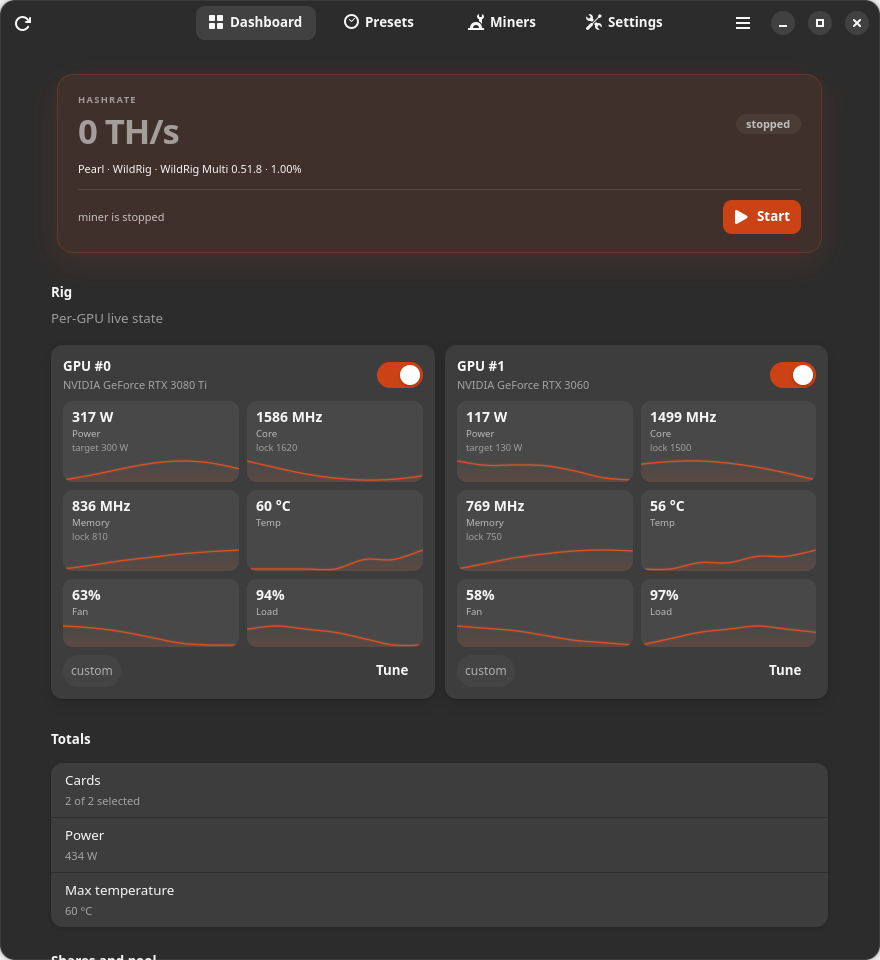

# Trommel

**English** · [Русский](README.ru.md)

Trommel is a GTK4/libadwaita control room for NVIDIA mining rigs. It manages
miners, pools, coins, GPU profiles and reusable presets — without turning your
desktop into a pile of shell scripts.

<picture>
  <source media="(prefers-color-scheme: dark)" srcset="docs/images/dashboard-en-dark.png">
  <source media="(prefers-color-scheme: light)" srcset="docs/images/dashboard-en-light.png">
  
</picture>

<sub>Dashboard with two GPUs. The image follows your system colour scheme; the dark
theme is used here by default.</sub>

> Trommel is a manager, not a miner. Miner binaries are downloaded separately,
> only one miner runs at a time, and the app restores the stock power limit and
> clocks when mining stops.

**Who it is for:** a home PC with one to three NVIDIA cards. It is a local,
simpler alternative to a full mining OS — not a remote farm dashboard, not an
OS replacement, and not a wallet. Start with **Simple mode**; advanced miner
arguments are hidden until you turn them on.

## Features

- **Multi-GPU dashboard** — per-card temperature, power, fan, clocks and
  utilization; rig power and the hottest card's temperature for the whole rig,
  each with a per-card breakdown in its tooltip.
- **Per-GPU participation** — switch a card off to exclude it from the active
  miner: it is not passed to the miner and is not tuned, and the card is marked
  `excluded`. WildRig, SRBMiner and OneZero use their documented device flags; a
  miner without one refuses a partial rig instead of mining on every card.
- **Presets** — bundle the coin/algorithm (Pearl/pearlhash in the current
  catalogue), pool, wallet, worker, miner version and miner-specific options.
  GPU settings are edited on each card's Tune dialog, so switching presets does
  not re-enter everything.
- **Miner library and version manager** — short description, every installed
  version with the presets that pin it, binary state, verify/remove actions and
  a link to the upstream release page. A newer build is installed without
  touching a preset; you then choose which presets to move. The developer fee is
  shown as a breakdown (miner + pool = total) in the dashboard and the preset
  editor.
- **Miner-dependent settings** — option descriptors come from the selected
  miner in the catalogue: types, ranges, defaults and CLI flags. Values whose
  keys no longer exist are dropped when the miner changes.
- **One install, all presets** — a single install dialog owns the version
  list (catalogue plus your own imported builds), downloads over HTTPS and
  imports local binaries. Install a version once; every preset that references
  it sees it as installed, and missing versions block Start until resolved.
  Older versions stay installed for rollback, removal of a pinned version is
  refused, and switching a preset to another installed version changes only that
  preset.
- **Preset editor as a dialog** — rows open a modal editor with Save/Cancel,
  duplicate and a confirmation before deleting; no in-page Back navigation.
- **Appearance** — System, Light or Dark colour scheme applied immediately and
  remembered across restarts. Trommel uses libadwaita's own styling and the
  system GTK theme, so it matches other GNOME apps on the same desktop.
- **Stock snapshot** — before applying power/clocks, Trommel captures each
  GPU's current power limit and restores it on stop (on by default). No
  hardcoded power limit.
- **Optional clock locks** — core/memory locks are off by default; enable them
  per card, copy to identical cards or all GPUs. A lower memory lock can save
  power on some coins and hurt others, so it is an advanced choice.
- **Per-card tuning** — each dashboard card shows live power, clocks,
  temperature, fan and load in value bubbles and opens **Tune** for power and
  clock locks; simple mode hides the clock rows.
- **Safe apply flow** — if the miner is running and you edit the profile, you
  choose **Apply and restart** or **Apply and stop**; failures roll back.
- **Simple mode by default** — ordinary users see power, temperature and Start;
  advanced miner options and raw arguments are one switch away.
- **Agent-friendly** — JSON config, CLI diagnostics, diff/apply commands and an
  optional MCP server for Codex/other agents. The agent proposes; you see the
  diff and approve.
- **English and Russian UI**, the desktop GTK theme (Yaru, Adwaita), light and dark colour schemes, GNOME HIG-style widgets.

## Supported setup

- Linux with GNOME Shell 50 (Ubuntu 26.04 is the tested target), Wayland.
- NVIDIA GPU + working `nvidia-smi` and driver.
- For development: Rust 1.92+, `libgtk-4-dev`, `libadwaita-1-dev`, `pkg-config`.

AMD/Intel, X11-specific paths and non-GNOME desktops are not supported.

## Install

### GitHub release (recommended)

Trommel is distributed from **GitHub Releases**; there is no apt repository or
PPA. Download the latest release from
<https://github.com/nayvok/trommel/releases/latest> and install the `.deb`:

```bash
sudo apt install ./trommel_amd64.deb
```

Or use the installer, which downloads the latest `.deb`, verifies its SHA-256
and installs it:

```bash
curl -fsSLO https://github.com/nayvok/trommel/releases/latest/download/trommel-install.sh
bash trommel-install.sh
```

The package contains the app, `trommeld`, the polkit helper, desktop entry,
icons and metainfo. The daemon starts on demand over D-Bus; GPU tuning works
without a password for the user who ran the install.

Upgrade by installing the new release's `.deb`; remove with
`sudo apt remove trommel`. The dev install below is for contributors.

### Developer install

```bash
./install.sh             # build, install and enable the user service
./install.sh --no-helper # without the polkit helper (no OC)
```

The script installs binaries to `~/.local/bin` and the helper to
`/usr/libexec/trommel/`. It asks for `sudo` once for the helper and polkit rule.

### Other formats

RPM, AppImage and Flatpak are **not released**. Reasons and the current
status are documented in [docs/packaging.md](docs/packaging.md). Flatpak cannot
provide the host `nvidia-smi`/polkit/systemd integration this app needs without
a broad sandbox; a GUI-only Flatpak would be a different product.

## First run

A **Quick setup** button appears on the dashboard until a wallet and an installed
miner are ready. It opens a three-step wizard for a 1–3 card rig:

1. **Cards** — tick the cards to mine on and give each one a power limit
   (**Apply 80 %** fills the ticked cards from their stock limit, expands them
   and shows the applied watts; **Use auto** = no limit). An unticked card is
   excluded from mining and is not tuned.
2. **Miner** — choose a miner and version, then **Install…**: the dialog can
   download a catalogue version, take a version name that is newer than the
   catalogue, or import a local binary. One installation serves every preset.
3. **Wallet** — preset name, wallet, worker, pool and pool address. Nothing is
   sent to the daemon or started until you press **Start mining**; a running
   miner gets the usual Apply and restart / Apply and stop dialog instead of a
   silent restart.

Presets open in a modal editor, and the same install dialog serves the miner
library dialog, the editor and the wizard.

The classic path still works:

1. Open **Trommel** from the application menu.
2. Open a preset row: the editor is a modal window with pool → miner/version
   (install or import a binary) → wallet/worker → fees → miner options.
3. Choose **Save** (it saves and applies). If the miner is stopped, it is saved immediately;
   if it is running, you get the restart/stop dialog.
4. Press **Start**. Trommel snapshots the stock power limit and applies the
   selected profile before spawning the miner.
5. Press **Stop** to terminate the miner and restore the snapshot.

The app never ships a wallet or a miner binary. A pre-Trommel Pearl Miner
configuration is imported once from `~/.config/pearl-miner/config.json`; the old
file is left untouched.

## CLI

```bash
trommel status               # human-readable
trommel status --json        # contract used by the GUI and CLI
trommel start / stop / toggle
trommel preset list          # show presets and their total fee
trommel preset use <id> --restart
trommel miner list           # catalogue + installed versions and their presets
trommel miner import wildrig 0.51.8 /path/to/wildrig-multi
trommel miner install wildrig 0.51.8 https://example.org/miner.tar.gz \
  --sha256 <hex> --archive tar.gz --binary wildrig-multi
trommel miner verify         # check every installed binary; --json for agents
trommel miner remove wildrig 0.51.7 --yes   # only an unused version
trommel bench --minutes 3
trommel diagnose --json > diagnostics.json
trommel config diff proposed.json
trommel config apply proposed.json --restart
trommel mcp                  # read-only MCP server over stdio
```

The daemon is the single source of truth. The GUI can be closed; the miner
keeps working.

## Fees and miner info

The miner library shows a short description and every installed version; the
install dialog lists catalogue versions and links to the upstream release page.
The
preset editor shows the selected miner's description, install path and fee
breakdown:

```
miner 0.00% + pool 1.00% = total 1.00%
```

A miner fee is editable **only** when the catalogue marks it configurable; the
UI never pretends a fixed fee can be changed. The pool fee is used for effective
hashrate calculation and is editable per preset.

## Stock restore and limitations

- Power limit is restored from the snapshot captured before mining.
- `-lgc`/`-lmc` are reset to the driver default. A pre-existing manual clock
  lock cannot be read back through `nvidia-smi`; this is documented in the UI.
- Fan control on consumer cards is not available through `nvidia-smi`; fan
  flags are passed to the miner when supported and disappear with the process.
- On reboot the snapshot is marked stale and is not used; Start captures a fresh
  one, and the driver resets GPU settings anyway.

## Notifications

**Behavior → Notifications** turns crash, error and overheat alerts into regular
desktop notifications. `trommeld` sends them through
`org.freedesktop.Notifications`, so they work on any freedesktop desktop; the
same events are also emitted as the `Notification` D-Bus signal for custom
integrations. No shell extension is installed.

## Documentation

Start at the [documentation index](docs/README.md). The most used entry points:

- [User guide](docs/user-guide.md) · [Русский](docs/user-guide.ru.md)
- [Architecture](docs/architecture.md) · [Components](docs/components.md)
- [Design](docs/design.md) · [Русский](docs/design.ru.md)
- [Development and test harness](docs/development.md)
- [Miner catalogue and options](docs/miners.md)
- [Using Trommel from an external agent](docs/agents.md)
- [Packaging and releases](docs/packaging.md)
- [Verification](docs/verification.md)
- [Security model](docs/security.md)
- [Roadmap](docs/roadmap.md)

## Contributing

See [CONTRIBUTING.md](CONTRIBUTING.md) / [Русский](CONTRIBUTING.ru.md) and
[AGENTS.md](AGENTS.md). Feature branches and Conventional Commits are expected.

## License

**License is not chosen yet.** The old MIT claim was removed; the AppStream
metadata currently uses `LicenseRef-proprietary`. Mining binaries are not
distributed by this project; their licenses are listed on their upstream pages.

## Disclaimer

Mining consumes power and generates heat. You are responsible for your hardware,
electricity, pool fees, wallet security and local laws. Start with conservative
power limits and monitor the first run.
