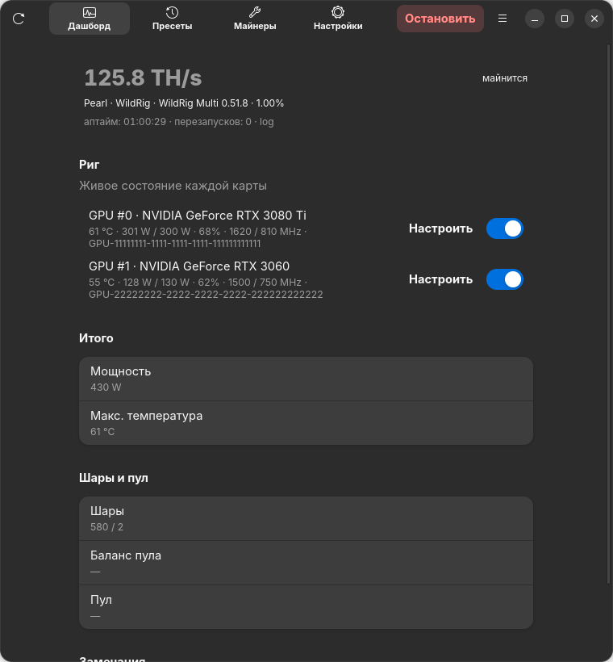

# Trommel

[English](README.md) · **Русский**

Trommel — пульт управления NVIDIA-ригом на GTK4/libadwaita. Он хранит майнеры,
пулы, монеты, профили GPU и готовые пресеты, чтобы не превращать рабочий стол в
набор shell-скриптов.



> Trommel — менеджер, а не майнер. Бинарники майнеров скачиваются отдельно,
> одновременно работает только один майнер, а при остановке возвращается
> стоковый лимит питания и частоты.

**Для кого:** домашний ПК с одной–тремя картами NVIDIA. Это локальная простая
альтернатива полноценной mining-OS, а не пульт удалённой фермы, не замена ОС и
не кошелёк. Начните с **простого режима**; продвинутые аргументы майнера
скрыты, пока вы их не включите.

## Возможности

- **Мульти-GPU дашборд** — температура, мощность, вентилятор, частоты и загрузка
  каждой карты; суммарная мощность, температура и эффективность рига.
- **Пресеты** — монета, пул, кошелёк, воркер, версия майнера, профиль GPU и
  настройки майнера в одном месте; переключение без повторного ввода.
- **Каталог майнеров** — краткое описание, версия, источник, лицензия,
  комиссия разработчика и поддерживаемые алгоритмы. Комиссия везде показана
  разбивкой: майнер + пул = итог.
- **Настройки зависят от майнера** — типы, диапазоны, значения по умолчанию и
  CLI-флаги берутся из каталога для выбранной версии. Есть сброс к defaults
  майнера.
- **Одна установка — все пресеты** — версия майнера ставится один раз и
  отображается установленной во всех пресетах. Если её нет, показывается
  кнопка скачивания/импорта, а старт блокируется.
- **Снимок стока** — перед применением питания/частот сохраняется текущий лимит
  каждой карты и восстанавливается при остановке. Никакого хардкода `-pl 350`.
- **Безопасное применение** — если майнер работает, при изменении профиля
  предлагается **Применить и перезапустить** или **Применить и остановить**;
  ошибка откатывает конфиг.
- **Интеграция с GNOME** — индикатор в панели, живой поповер, переключатель в
  Quick Settings и настраиваемые подписи. Приложение включает расширение и
  отражает его состояние из Extension Manager.
- **Простой режим по умолчанию** — обычный пользователь видит питание,
  температуру и «Запустить»; продвинутые настройки — одним переключателем.
- **Дружелюбно к агентам** — JSON-конфиг, CLI-диагностика, diff/apply и
  опциональный MCP-сервер для Codex/других агентов. Агент предлагает — вы
  видите diff и подтверждаете.
- **Английский и русский**, светлая и тёмная темы, виджеты в духе GNOME HIG.

## Требования (v1)

- Linux с GNOME Shell 50 (тестируемая цель — Ubuntu 26.04), Wayland.
- NVIDIA GPU + рабочие `nvidia-smi` и драйвер.
- Для разработки: Rust 1.80+, `libgtk-4-dev`, `libadwaita-1-dev`, `pkg-config`.

AMD/Intel, X11-специфика и не-GNOME окружения в v1 не поддерживаются.

## Установка

### Debian-пакет (рекомендуется для v1)

```bash
sudo apt install ./dist/trommel_0.2.0_amd64.deb
```

Пакет содержит приложение, `trommeld`, polkit-хелпер, desktop-файл, иконки,
metainfo, GSettings-схему и расширение GNOME. Демон запускается по D-Bus;
расширение включается в **Настройки → Интеграция с GNOME** (или в менеджере
расширений). На Wayland может понадобиться перелогиниться.

### Установка для разработки

```bash
./install.sh                 # сборка, установка, сервис и расширение
./install.sh --no-extension  # без апплета в панели
./install.sh --no-helper     # без polkit-хелпера (без разгона)
```

Скрипт ставит бинарники в `~/.local/bin`, хелпер в `/usr/libexec/trommel/`,
расширение — в пользовательский каталог. Один раз спросит `sudo` для хелпера и
polkit-правила.

### Другие форматы

RPM, AppImage и Flatpak **в v1 не релизятся**. Причины и статус —
в [docs/packaging.md](docs/packaging.md). Flatpak не может дать доступ к
host-`nvidia-smi`, polkit, systemd и расширению без широкой песочницы;
GUI-only Flatpak — это уже другой продукт.

## Первый запуск

Кнопка **Быстрая настройка** появляется на дашборде, пока не задан кошелёк и не установлен майнер.

1. Откройте **Trommel** из меню приложений.
2. Создайте пресет: монета → пул → майнер/версия (импорт или установка) →
   кошелёк/воркер → профиль GPU → настройки майнера.
3. Нажмите **Сохранить и применить**. Если майнер остановлен, настройки
   сохранятся сразу; если работает — появится диалог перезапуска/остановки.
4. Нажмите **Запустить**. Trommel снимает стоковый лимит и применяет профиль
   перед запуском майнера.
5. Нажмите **Остановить**, чтобы завершить майнер и восстановить снимок.

Приложение не содержит кошелька и бинарников майнеров. Старый конфиг Pearl
Miner импортируется из `~/.config/pearl-miner/config.json` при первой загрузке.

## CLI

```bash
trommel status               # человекочитаемо
trommel status --json        # контракт для GUI/расширения
trommel start / stop / toggle
trommel preset list          # пресеты и итоговая комиссия
trommel preset use <id> --restart
trommel miner list           # каталог и установленные версии
trommel miner import wildrig 0.51.8 /path/to/wildrig-multi
trommel miner install wildrig 0.51.8 https://example.org/miner.tar.gz \
  --sha256 <hex> --archive tar.gz --binary wildrig-multi
trommel bench --minutes 3
trommel diagnose --json > diagnostics.json
trommel config diff proposed.json
trommel config apply proposed.json --restart
trommel mcp                  # read-only MCP-сервер поверх stdio
```

Демон — единственный источник правды. GUI можно закрыть; индикатор и майнер
продолжат работать.

## Комиссии и информация о майнере

Страница майнера показывает краткое описание, версию, источник, лицензию,
комиссию разработчика, поддерживаемые монеты/алгоритмы и установленные версии.
В редакторе пресета та же информация и разбивка:

```
майнер 0.00% + пул 1.00% = итого 1.00%
```

Комиссия майнера редактируется **только** если в каталоге стоит
`fee_configurable=true`; UI не делает вид, что фиксированную комиссию можно
поменять. Комиссия пула используется для расчёта effective hashrate и
редактируется для custom-пулов.

## Восстановление стока и ограничения

- Лимит питания восстанавливается из снимка, снятого до майнинга.
- `-lgc`/`-lmc` сбрасываются в дефолт драйвера. Свой ручной лок, стоявший до
  нас, через `nvidia-smi` не прочитать; это ограничение описано в UI.
- Вентилятор на consumer-картах через `nvidia-smi` не управляется; fan-флаги
  уходят майнеру, если он их поддерживает, и исчезают вместе с процессом.
- После перезагрузки снимок считается stale и удаляется; драйвер и так
  сбрасывает настройки GPU.

## Расширение GNOME

Расширение входит в пакет и видно в Extension Manager. Отдельного окна
настроек у него нет: режим подписи, live activity и переключатель Quick
Settings настраиваются в **Trommel → Настройки → Интеграция с GNOME** через
общую GSettings-схему. Если выключить расширение в Extension Manager,
приложение покажет «выключено». Демон работает и без расширения.

## Документация

- [Руководство пользователя](docs/user-guide.ru.md) · [English](docs/user-guide.md)
- [Архитектура](docs/architecture.md)
- [Каталог майнеров и опции](docs/miners.md)
- [Использование Trommel внешним агентом](docs/agents.md)
- [Статус упаковки](docs/packaging.md)
- [Расширение GNOME](docs/extension.md)
- [Модель безопасности](docs/security.md)
- [Планы](docs/roadmap.md)

## Участие

См. [CONTRIBUTING.ru.md](CONTRIBUTING.ru.md) / [English](CONTRIBUTING.md) и
[AGENTS.md](AGENTS.md). Ожидаются feature-ветки и Conventional Commits.

## Лицензия

**Лицензия пока не выбрана.** Ложный MIT убран; в AppStream сейчас
`LicenseRef-proprietary`. Расширение GNOME — `GPL-3.0-or-later`, потому что это
производная GNOME Shell. Бинарники майнеров проект не распространяет; их
лицензии — на страницах авторов.

## Дисклеймер

Майнинг расходует электричество и греет железо. Ответственность за железо,
электричество, комиссии пулов, безопасность кошелька и местные законы — на вас.
Начинайте с консервативного лимита питания и следите за первым запуском.
