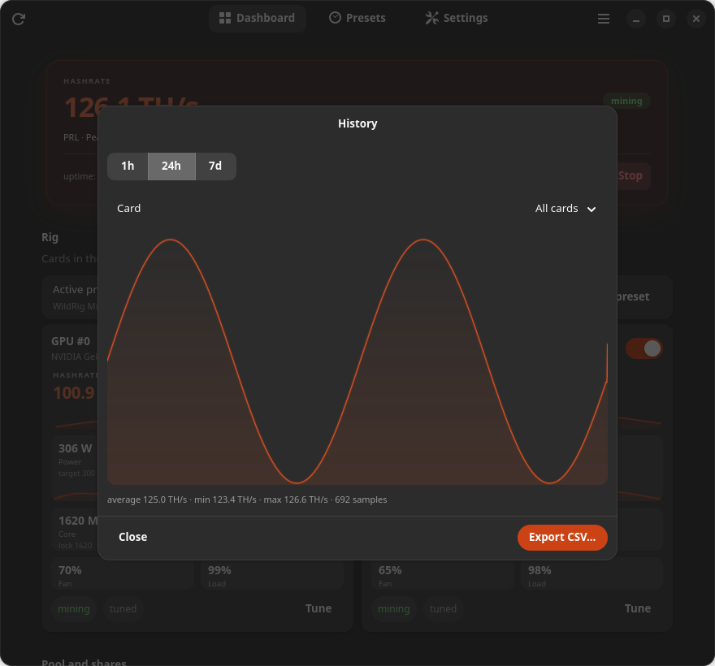

# Дизайн

Это UX- и визуальная спецификация Trommel. Документ для тех, кто добавляет
экран, строку или предупреждение: новая работа должна выглядеть как остальное
приложение без отдельного ревью дизайна. Код — в `crates/cli/src/gui.rs`, карта
компонентов — в [components.md](components.md).

Английский оригинал: [design.md](design.md).

## Позиция продукта

Trommel — это **пульт управления**, а не дашборд для наблюдателей и не майнер.
Он должен ощущаться как спокойная системная утилита:

- **Безопасное действие — очевидное.** По умолчанию консервативные настройки
  (без локов частот, авто-лимит питания, один майнер), а рискованное действие
  всегда явное и названо своим именем.
- **Показывать состояние, а не украшения.** Хешрейт, температура, питание и
  комиссии — это продукт. Цвет и анимация только уточняют состояние.
- **Постепенное раскрытие.** Простой режим показывает питание, температуру и
  «Запустить». Продвинутые настройки есть, но не мешают первому запуску.
- **Одна задача — одно место.** Установка майнера — один диалог; у пресета —
  один редактор; навигация — один переключатель в шапке.
- **Никакой лжи.** Выключенный элемент объясняет причину; неудачный возврат
  стока виден; фиксированная комиссия показана только для чтения;
  несохранённый черновик заметен.

## Платформа

- GTK 4.22 и libadwaita 1.9 (`gtk4` `v4_22`, `libadwaita` `v1_9`).
- Тестируемая цель — GNOME 50 / Ubuntu 26.04, Wayland. Окно должно оставаться
  рабочим при ширине ~400 px.
- Используются штатные виджеты libadwaita (`AdwPreferencesPage`,
  `AdwPreferencesGroup`, `AdwActionRow`, `AdwSpinRow`, `AdwSwitchRow`,
  `AdwComboRow`, `AdwBanner`, `AdwToastOverlay`, `AdwAlertDialog`,
  `AdwViewStack`, `AdwViewSwitcherTitle`, `AdwViewSwitcherBar`, `AdwClamp`,
  `AdwToolbarView`, `AdwWrapBox`, `AdwDialog`).
- Никакой собственной модели навигации, подмены контента главного окна или
  web-view.

## Визуальная система

### Тема

Trommel использует штатное оформление libadwaita и наследует тему GTK рабочего
стола (Yaru в Ubuntu, Adwaita в чистом GNOME). **Переключателя GTK-темы в
приложении принципиально нет:** принудительный `GTK_THEME` заставляет
libadwaita пропустить свой stylesheet и ломает отступы и цвета.

**Настройки → Поведение → Оформление** выбирает только цветовую схему —
системную, светлую или тёмную — и применяет её сразу. Для скриншотов и тестов
её переопределяет `TROMMEL_COLOR_SCHEME`.

### Сетка и отступы

| Параметр | Значение |
| --- | --- |
| Окно по умолчанию | 880 × 760 |
| Минимальное окно | 400 × 420 |
| Колонка дашборда | clamp 900 px (карточки расширяются шире текстовой колонки) |
| Отступы дашборда | 18 px сверху, 24 px снизу, по 12 px с боков |
| Карточки GPU | `AdwWrapBox` с fill-выравниванием, зазор 10 px, минимум 240 px |
| Анимация страниц | `AdwViewStack`, 220 мс |
| Ширина настроек | стандартная для libadwaita (~600 px) |

Не задавайте минимальную ширину окна из строк настроек: «Настройки» состоят из
стандартных компактных `AdwActionRow` и не растягивают окно.

### Типографика и акценты

- Используйте штатные классы `title-*`, `heading`, `body`, `caption`,
  `numeric`, `dim-label`. Свои размеры есть только у хешрейта в hero-карточке
  (`.trommel-hero-hashrate`, 2.6 em, вес 800), подписи hero-карточки, подписей
  метрик и чипов; больше не добавляйте.
- Цифры — табличные (`font-feature-settings: "tnum"`), чтобы живые значения не
  «прыгали».
- Подписи — в предложении с заглавной буквы. Капс — только для короткого текста
  статусной пилюли и подписи hero-карточки.

### Карточки, пилюли и чипы

Собственный CSS живёт в `install_css()`:

| Класс | Назначение |
| --- | --- |
| `.trommel-hero` | Hero-карточка хешрейта: акцентный фон, рамка 1 px, радиус 16 px |
| `.trommel-hero-caption` | Мелкая подпись HASHRATE с разрядкой |
| `.trommel-hero-hashrate` | Крупное значение хешрейта |
| `.trommel-hero-line`, `.trommel-hero-rule`, `.trommel-hero-meta` | Строка пресета, разделитель и строка аптайма/перезапусков |
| `.trommel-gpu-card` | Карточка GPU на дашборде: радиус 12 px, фон карточки, мягкая тень |
| `.trommel-gpu-card-wide` | Карточка единственного GPU: увеличенные отступы, на всю ширину дашборда |
| `.trommel-gpu-stat` | «Пузырь» живого значения в карточке GPU: лёгкий фон, радиус 10 px |
| `.trommel-gpu-stat-value`, `-label`, `-hint` | Крупное табличное значение, мелкая подпись, приглушённая цель/лок |
| `.trommel-gpu-title` | Вес заголовка карточки |
| `.trommel-gpu-chip` | Чип «сток/настроено/пресет GPU» и компактный живой чип (пилюля, табличные цифры) |
| `.trommel-pill` + `-running`, `-external`, `-stopped`, `-offline` | Статусная пилюля |
| `.trommel-hot`, `.trommel-warm`, `.trommel-muted` | Температура и приглушение |
| `button.pill` | Компактная скруглённая кнопка (мин. высота 26 px) |

Радиусы: 12 px у карточек, 999 px у пилюль. Тень — только у карточек GPU на
дашборде; карточки настроек используют рамку 1 px.

### Цвет

Цвет **информационный и никогда не единственный носитель смысла**:

- хешрейт и акцентные действия — `accent`;
- работает — `success`; внешний/ручной майнинг — `warning`;
- нет связи — `error`;
- температура — `warning` (тепло), `error` (горячо);
- установлено — `success`; нет установки — `warning`/`error`;
- предупреждения — `warning`; второстепенные данные — `dim-label`.

Рядом с цветным значением всегда есть слово («установлен», «не установлен»,
«отклонено», «нет связи»). Нельзя кодировать состояние только цветом.

### Анимация и обратная связь

- Переключение страниц анимируется; диалоги используют системный переход.
- Тосты подтверждают фоновую работу: применено, установлено, сток возвращён,
  диагностика скопирована, лучший майнер найден.
- Ошибки показывает тот диалог, который их вызвал (установка, редактор,
  тюнинг); сбой фонового действия виден в тосте с кнопкой **Подробнее**. В окне
  подробностей текст можно выделить и скопировать.
- Карточка GPU на дашборде не кликабельна: действия — только **Настроить** и
  переключатель участия, а спарклайн добавляет лишь подсказку, поэтому
  hover-эффекта у карточки нет. Выключение переключателя — применимое изменение:
  при работающем майнере оно открывает диалог применения, а «Отмена»
  возвращает переключатель.
- Кнопка **Запустить** на дашборде неактивна, пока все обнаруженные карты
  исключены из майнинга или пока майнер не умеет выбирать карты; причина видна
  в замечаниях и подсказке кнопки.
- Кнопка «Запустить» меняет текст на «Запускаю…» и блокируется, пока демон
  работает.

## Навигация

1. **Главное окно никогда не подменяет контент подэкраном.** Вторичные экраны —
   модальные `AdwDialog` внутри главного окна, как диалог настроек Nautilus.
   Кнопок «Назад» внутри страниц нет.
2. **Одна поверхность навигации.** `AdwViewSwitcherTitle` в шапке: три
   страницы занимают место заголовка, пока окно достаточно широкое для иконок и
   подписей. Когда не хватает ширины, возвращается заголовок, а внизу
   показывается `AdwViewSwitcherBar` — переключатель не обрезается и не
   дублируется. В шапке только навигация и хром окна (обновить, переключатель,
   меню): главное действие «Запустить/Остановить» живёт на дашборде, поэтому
   однострочный переключатель держится примерно до 850 px — окно по умолчанию
   880×760 даёт одну строку в обоих языках, а при меньшей ширине подписи
   складываются под иконки, оставаясь в шапке.
3. **Страница — это место, куда возвращаются, а не шаг сценария.** Углубление
   всегда открывает диалог; закрытие возвращает страницу как была.
5. **Разрушительные и требующие перезапуска действия спрашивают первыми**
   (`AdwAlertDialog`): применение при работающем майнере, удаление пресета,
   перезапись профиля.
6. **Клавиатура:** `Ctrl+Q` — выход; `Esc` закрывает диалоги. В шапке диалога
   только заголовок и кнопка закрытия; если «Отмена»/«Закрыть» есть в нижней
   панели, автоматическая кнопка закрытия убирается, чтобы не было двух
   способов закрыть окно.

## Карта экранов

| Экран | Тип | Открывается из | Назначение |
| --- | --- | --- | --- |
| Главное окно | `AdwApplicationWindow` | запуск | Шапка (переключатель, обновить, меню), три страницы, баннеры |
| Дашборд | страница | переключатель страниц | Hero-хешрейт, активный пресет, карточки GPU, шары и пул, предупреждения |
| Пресеты | страница | переключатель страниц | Список пресетов, вход в библиотеку майнеров; строка открывает редактор |
| Настройки | страница | переключатель страниц | Поведение, надёжность (сторож), GPU, оформление, действия |
| Редактор пресета | `AdwDialog` | строка пресета / «Новый пресет» | Один пресет: майнер, версия, пул, кошелёк, комиссии, опции |
| Библиотека майнеров | `AdwDialog` | страница «Пресеты» / редактор пресета | Каталог, установленные версии с использованием, проверка/удаление, переключатель версии пресета, бенчмарк, вход в установку |
| Установка майнера | `AdwDialog` | строка библиотеки, редактор, мастер | Выбор версии, HTTPS-загрузка, локальный импорт |
| Перевод пресетов на версию | `AdwAlertDialog` | библиотека после установки | Флажки по пресетам; ничего не отмечено, «оставить» — по умолчанию |
| Удаление версии майнера | `AdwAlertDialog` | строка версии в библиотеке | Подтверждение для неиспользуемой версии; блокирующее предупреждение со списком пресетов |
| Настройка GPU | `AdwDialog` | карточка на дашборде | Питание и локи карты; копирование на одинаковые/все |
| Пресеты GPU | `AdwDialog` | Настройки → GPU | Переименование и удаление сохранённых шаблонов карт |
| История | `AdwDialog` | Кнопка **История** в hero | Локальный график 1 ч / 24 ч / 7 д, выбор карты, экспорт CSV |
| Диалог применения | `AdwAlertDialog` | применение при майнинге | Применить и перезапустить / остановить / отмена |
| Удаление пресета | `AdwAlertDialog` | редактор пресета | Подтверждение удаления |
| Меню трея | StatusNotifierItem | иконка в панели | Строка статуса, запуск/остановка, показать окно, выход |
| About / лог / выбор файла | системные | меню, установщик | Стандартные поверхности |

## Экраны

### Дашборд

- Hero-карточка: мелкая подпись HASHRATE с разрядкой, крупное значение,
  статусная пилюля (`майнится` / `вручную` / `остановлен` / `нет связи`), строка
  «монета · пул · комиссия», разделитель и одна спокойная строка метаданных с
  аптаймом, перезапусками, expected/actual хешрейтом и эффективностью
  (`3.42 J/TH`); источник данных майнера — в подсказке. Имя пресета здесь **не** повторяется: оно живёт
  в строке Active preset. Карточка с акцентным фоном и мягкой тенью; значение
  окрашено акцентом, только когда хешрейт известен. Запущенный майнер без
  данных показывает `—`, а не `0`; `0` в единице монеты — заглушка только для
  остановленного состояния. Карточку закрывает главная кнопка
  **Запустить/Остановить** (иконка play/stop, пилюля; suggested в покое и
  destructive при майнинге) — внизу справа, в одной строке с метаданными: самая
  яркая кнопка приложения стоит на той карточке, которой управляет, а не висит
  в шапке.
- Карточки GPU: название и индекс, переключатель участия карты в сессии
  майнинга (выключен = исключена: не передаётся майнеру и не разгоняется),
  **якорь хешрейта** над «пузырями»: мелкая подпись HASHRATE, значение карты
  в единице монеты (или `—`, если майнер не отдаёт данные / запись не удалось
  сопоставить) и спарклайн за пять минут. Это визуальный якорь, а не седьмой
  равный «пузырь»; реальный ноль сопровождается словом «нет хешрейта».
  Шесть «пузырей» со значениями (питание, температура, ядро, память,
  вентилятор, загрузка; цель/лок — мелкая подсказка, краснеет при расхождении с
  живым значением), чип **майнит**/**исключена**, чип **сток/настроено/пресет GPU** и кнопка
  **Настроить**. Чип участия описывает применённую сессию, а не черновик: после
  смены переключателя он продолжает говорить «майнит», пока изменения не
  применены. Спарклайн остаётся только у **питания** и **температуры**:
  последние пять минут метрики тонкой акцентной линией поверх мягкой заливки,
  со скруглением углов пузыря. Ядро, память, вентилятор и загрузка — значения,
  а не тренды; без их графиков карточка спокойнее, а строки сетки не прыгают.
  Заливка доходит до скруглённого низа, а у графика остаётся всего 2 px отступа,
  поэтому он «стоит» на нижней кромке пузыря, а не висит над ней. Линия повторяет
  цвет значения, поэтому тёплый или горячий пузырь рисует тёплую или красную
  линию. Спарклайн хешрейта сверху рисуется тем же кодом. История спарклайнов живёт в GUI (стартует пустой и наполняется с
  частотой опроса), а не в статусе демона. Риг из одной карты получает одну
  карточку на всю ширину с сеткой 3×2; при 2+ картах карточки складываются в
  wrap-контейнер и делят строку поровну (минимум 240 px). Частоты ядра и памяти
  подписаны раздельно.
- Над карточками строка **Active preset**: имя пресета, майнер/версия, число
  карт, сток/настроено, питание и температура рига, кнопка **Изменить пресет**.
  Роли карт, питание и температура по каждой карте — в подсказке строки. Питание
  суммирует `power.draw` по всем найденным картам (исключённая карта тоже
  считается — она всё равно потребляет), температура — показание самой горячей
  карты. Отдельной группы «Итоги» нет.
- **Пул и шары** — одна группа максимум из трёх компактных строк: имя/хост пула,
  endpoint, комиссия и наличие API; принятые/отклонённые/устаревшие шары с
  процентом принятия; баланс к выплате в символе монеты. Без документированного
  API или до первого ответа баланс — `—` со спокойным объяснением в подсказке;
  это никогда не `0.000`. При отсутствии пресета группа скрыта, чтобы на первом
  запуске не было пустой таблицы.
- В остановленном состоянии баланс, шары и неизвестный хешрейт — `—`; числовой
  `0` появляется только если майнер или пул действительно сообщил ноль. Прочерк
  означает «неизвестно», а не ошибку и не ноль.
- Предупреждения — одна строка с объединённым текстом и значком warning; тот же
  список есть в статусе.
- При отсутствии пресета hero становится первым запуском: «Нет пресета»,
  короткое объяснение и **Создать пресет**; Start объясняет то же самое.

### Пресеты

- Активируемые `AdwActionRow` в группе; шеврон — настоящая кнопка, открывает
  редактор.
- Подзаголовок: монета, пул, майнер и версия. Если закреплённой версии нет,
  вторая строка подзаголовка сообщает об этом, а кнопка **Установить…**
  открывает библиотеку майнеров с фокусом на этом пресете. Активный пресет
  получает бейдж «Активен», у остальных есть кнопка **Использовать**.
- **Новый пресет** создаёт копию активного пресета и открывает редактор.
- **Использовать** применяет выбор (с диалогом перезапуска/остановки при
  работающем майнере).
- Группа **Библиотека майнеров** под списком открывает модальную библиотеку.
  Установленные версии глобальны; пресет ссылается только на `miner` +
  `miner_version`.

### Редактор пресета (модальный)

- Шапка: имя пресета и подзаголовок «Пресет» (кнопки закрытия нет — «Отмена»
  и есть способ закрыть). Тело прокручивается; в нижней панели **Отмена** слева
  и **Сохранить** справа, а страница заканчивается группой
  **Дублировать**/**Удалить…**.
- Секции по порядку: **Пресет** (имя и строка сводки только для чтения),
  **Монета и пул** (монета, алгоритм, адрес пула, комиссия пула, подсказка
  известного пула), **Кошелёк** (кошелёк, воркер), **Майнер** (майнер, версия +
  **Установить…** + **Библиотека…**, описание, разбивка комиссии, состояние
  установки), **GPU** (сводка участия/настройки только для чтения; настройка —
  на дашборде) и **Дополнительно** (опции майнера, API пула, порт API,
  переопределение комиссии, доп. аргументы). Монета/алгоритм и GPU-значения
  здесь не редактируются. Библиотека открывается с пресетом сверху и его
  закреплённой версией, готовой к установке.
- Алгоритм для известной монеты только для чтения: он выводится из выбранной
  монеты, подсказка говорит «подставляется автоматически». Для своей монеты
  поле остаётся редактируемым и обязательным.
- Опции строятся из дескрипторов выбранного майнера. Значения, чьи ключи новый
  майнер не определяет, отбрасываются при сохранении пресета.
- Простой режим скрывает всю группу **Дополнительно**, но оставляет сводку и
  базовые группы монеты/кошелька/майнера/GPU.
- Сохранение применяет сразу: остановлен — сохранить; работает — диалог
  применения. Удаление спрашивает подтверждение, называет пресет и объясняет,
  что демон продолжит майнить с ранее применённым пресетом, пока не применят
  другой.

### Библиотека майнеров (модальный, менеджер версий)

- Открывается со страницы «Пресеты» и из редактора пресета; заменяет бывшую
  страницу «Майнеры». Из редактора сверху показывается сам пресет с его
  закреплённой версией и действием **Установить…**.
- Группа **Установленные версии**: по строке на майнер (каталог плюс свои
  сохранённые сборки) с кратким описанием, пресетами и их версиями, сводкой
  установленных версий (или **не установлен**) и шевроном, открывающим диалог
  установки. Ссылка на upstream-источник — в диалоге установки.
- Под майнером — по строке на установленную версию: версия в заголовке, иконка
  бинарника, подзаголовок со списком пресетов, состояние бинарника
  (`бинарник отсутствует`, `не исполняем`) и факт записи SHA-256, а также
  **Проверить** (иконка проверки) и **Удалить** (иконка корзины). У сломанного
  бинарника предупреждающий бейдж; выбрать его версией пресета нельзя. Строки
  никогда не вычисляют контрольную сумму.
- **Проверить** заново проверяет существование, тип файла, бит исполнения и
  читаемость, сообщает результат тостом и помечает строку как **проверено**
  (успех или предупреждение), пока библиотека открыта. **Удалить**
  блокируется, пока версию
  закрепил пресет: предупреждение перечисляет пресеты и объясняет, что сначала
  нужно сменить версию. Для неиспользуемой версии показывается разрушительное
  подтверждение: удаляются управляемые файлы, пресеты не меняются, другие
  версии остаются.
- **Обновление** — тот же диалог установки; после успешной установки окно
  показывает затронутые пресеты неотмеченными флажками, а **Оставить версии
  пресетов** — действие по умолчанию. Только выбранные пресеты переводятся, и
  только по явному **Перевести выбранные**.
- Группа **Версии в пресетах**: по `AdwComboRow` на пресет с его майнером,
  закреплённой версией и установленными исполняемыми версиями (отсутствующая
  версия показывается как `<версия> (нет)`). Выбор другой версии спрашивает
  **Сменить версию пресета?**; отмена возвращает переключатель, подтверждение
  закрепляет ровно этот пресет, закрывает библиотеку и запускает обычный
  сценарий применения/перезапуска/остановки.
- Библиотека никогда не переписывает пресет молча: установка только добавляет
  запись в глобальный `miner_installs`, удаление не меняет пресеты, а
  переключение версии затрагивает один пресет.
- Управление бенчмарком (минуты + **Сравнить**) запускает последовательный A/B
  тест; тост сообщает лучший effective-хешрейт. **Закрыть** закрывает диалог.

### Установка майнера (модальный, единственный)

Отвечает за всю установку для библиотеки майнеров, редактора пресета и мастера.
Две группы по порядку:

1. **Версия** — список версий из каталога **плюс** уже установленные свои
   сборки и редактируемое имя версии: можно поставить сборку новее каталога.
2. **Установка** — строка состояния (путь установки или «не установлен»),
   **Импортировать бинарник** для локального исполняемого файла, **Страница
   релиза**, если каталог знает домашнюю страницу, и раскрывающаяся строка
   **Источник загрузки** с HTTPS-URL, опциональным SHA-256, типом архива
   (`tar.gz`, `zip`, raw) и именем бинарника. Строка свёрнута, потому что
   версия из каталога заполняет эти поля сама; её подзаголовок показывает URL,
   так что до нажатия главной кнопки ничего не спрятано.

Пояснение про HTTPS/SHA-256 стоит в описании группы; ошибки — в строке
состояния нижней панели, успех даёт тост и обновляет вызывающий экран.
Отдельного бейджа «проверено» в диалоге нет. В нижней панели остаются только
**Отмена**, строка состояния и **Установить** — она помещается и в окно
400 px; короткая подпись и свёрнутые поля источника держат диалог внутри окна
760 px, и до его же нижней панели не нужно прокручивать.

Каталог — удобство, а не шлагбаум. Второй UI установки добавлять нельзя.

### Настройки

Группы по порядку:

1. **Поведение** — перезапуск при падении, возврат стока при остановке,
   уведомления, запуск Trommel при входе (systemd, сразу), монохромная иконка
   в трее (черновик), запуск майнинга при входе, порог температуры и
   температура возобновления (глобальные: один процесс майнера — одна
   температурная политика), простой режим, интервал опроса, язык (нужен
   перезапуск), оформление (сразу).
2. **Надёжность** — **Сторож хешрейта** (выключен по умолчанию; при включении
   только уведомляет), минимальный хешрейт (% от ожидаемого в пресете), окно в
   минутах, **При низком хешрейте** (только уведомлять / перезапускать майнер)
   и лимит перезапусков. Зависимые строки скрыты при выключенном
   переключателе; отдельная строка объясняет, что ожидаемый хешрейт не задан.
   Описание честно говорит о false positives; перезапуск никогда не
   перезагружает риг.
3. **GPU** — глобальная температурная политика и менеджер **Пресеты GPU**.
4. **Действия** — **Сохранить и применить**, **Копировать диагностику**,
   **Вернуть сток**. Кнопки выровнены по центру строки. «Вернуть сток» сначала
   спрашивает: снимок или сток драйвера, если они различаются; объясняет
   прежний сниженный лимит и последнюю ошибку возврата.

Правила:

- Переключатель карты на дашборде и диалог тюнинга применяются сразу
  (черновик + apply); «Отмена» в диалоге перезапуска/остановки обязана вернуть
  переключатель и баннер несохранённых изменений.
- Если настройки GPU остались применёнными при остановленном майнере, на
  дашборде показывается баннер с кнопкой **Вернуть сток**; то же состояние
  попадает в замечания.
- `Лимит питания = 0` означает «авто драйвера»; не зажимайте его в минимум.
- Диалог карты не делает вид, что управляет вентилятором или температурой: это
  глобальные/живые значения.

### Настройка GPU (модальный)

- Шапка: карта и активный пресет. В нижней панели **Отмена**, меню
  **Пресеты GPU** и **Сохранить**; Cancel/Esc отбрасывают локальные изменения
  без баннера и алерта применения.
- Строка **Сейчас** показывает живые питание/ядро/память/температуру, чтобы
  сравнить цель с реальностью.
- Лимит питания, лок ядра + значение, лок памяти + значение. Строка частоты
  появляется только при включённом локе; при выключенном подзаголовок называет
  текущее значение драйвера.
- Меню **Пресеты GPU**: **Сток (по умолчанию)**, сохранённые пресеты карты и
  **Сохранить как пресет GPU…**. Управление, переименование и удаление
  сохранённых шаблонов живёт в одном месте — **Настройки → GPU → Управление…**;
  меню в Tune только выбирает и сохраняет. Выбор пресета меняет только поля;
  Save пишет значения в per-card запись активного пресета.
- **Применить к** появляется только при нескольких картах: одинаковые или все
  GPU; копии становятся custom и не выдают себя за пресет другой карты.
- Удаление пресета майнинга удаляет только его GPU-значения; сохранённые
  пресеты GPU остаются.

### История (модальный)

- Открывается спокойной кнопкой **История** в футере hero; это диалог, а не
  четвёртая страница навигации. В шапке только заголовок; в футере **Закрыть**
  слева и **Экспорт CSV…** справа.
- Тело: связанный переключатель `1 ч | 24 ч | 7 д` (по умолчанию 24 ч), выбор
  карты (`Все карты` / `GPU #N`), график 220 px в языке существующих
  спарклайнов (акцентная линия, мягкая заливка, без сетки) и одна подпись
  `среднее … · мин … · макс … · N точек`. На графике одна серия, поэтому нет
  цветовой легенды и второй chart-библиотеки.
- Пустое состояние — одна центрированная подпись, без пустых осей. Загрузка —
  caption; ошибка чтения — тост с «Подробнее», а не пустой график, выдающий
  себя за ноль.
- Для рисования график прореживается до 720 точек; CSV хранит сырой long
  format (одна строка на GPU-сэмпл) и экранирует запятые/кавычки.
- В мета-строку hero может добавляться `среднее за 24 ч …`; оно считается по
  тем же локальным точкам, обновляется раз в минуту и не добавляет плитку или
  второй hero.

### Первый запуск

На чистой установке пресетов нет. Дашборд показывает карты и hero с кнопкой
**Создать пресет**; Start открывает алерт «Сначала создайте пресет» с той же
кнопкой. Новый пресет создаётся в редакторе как черновик: Cancel удаляет его
обратно, Save вставляет и делает активным. Никакого отдельного мастера нет.
