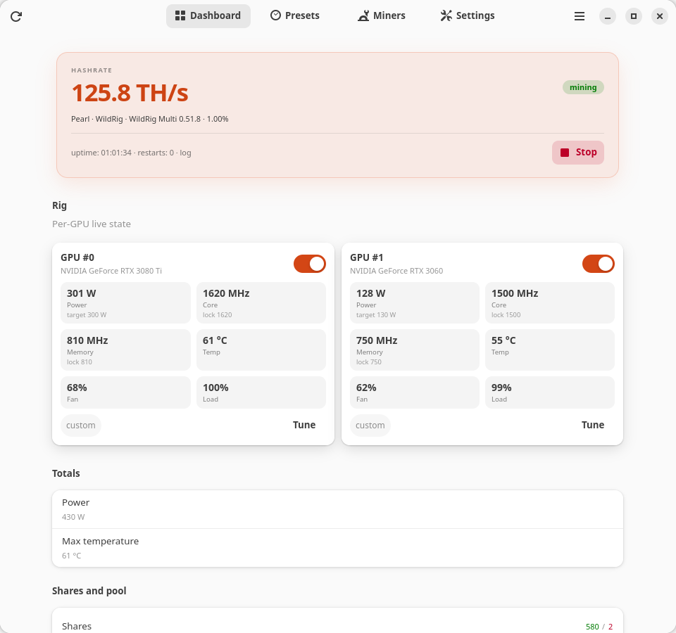

# Дизайн

Это UX- и визуальная спецификация Trommel. Документ для тех, кто добавляет
экран, строку или предупреждение: новая работа должна выглядеть как остальное
приложение без отдельного ревью дизайна. Код — в `crates/cli/src/gui.rs`, карта
компонентов — в [components.md](components.md).

Английский оригинал: [design.md](design.md).

## Позиция продукта

Trommel — это **пульт управления**, а не дашборд для наблюдателей и не майнер.
Он должен ощущаться как спокойная системная утилита:

- **Безопасное действие — очевидное.** По умолчанию консервативные настройки
  (без локов частот, авто-лимит питания, один майнер), а рискованное действие
  всегда явное и названо своим именем.
- **Показывать состояние, а не украшения.** Хешрейт, температура, питание и
  комиссии — это продукт. Цвет и анимация только уточняют состояние.
- **Постепенное раскрытие.** Простой режим показывает питание, температуру и
  «Запустить». Продвинутые настройки есть, но не мешают первому запуску.
- **Одна задача — одно место.** Установка майнера — один диалог; у пресета —
  один редактор; навигация — одна нижняя панель.
- **Никакой лжи.** Выключенный элемент объясняет причину; неудачный возврат
  стока виден; фиксированная комиссия показана только для чтения;
  несохранённый черновик заметен.

## Платформа

- GTK 4.22 и libadwaita 1.9 (`gtk4` `v4_22`, `libadwaita` `v1_9`).
- Тестируемая цель — GNOME 50 / Ubuntu 26.04, Wayland. Окно должно оставаться
  рабочим при ширине ~400 px.
- Используются штатные виджеты libadwaita (`AdwPreferencesPage`,
  `AdwPreferencesGroup`, `AdwActionRow`, `AdwSpinRow`, `AdwSwitchRow`,
  `AdwComboRow`, `AdwBanner`, `AdwToastOverlay`, `AdwAlertDialog`,
  `AdwViewStack`, `AdwViewSwitcherBar`, `AdwClamp`, `AdwToolbarView`).
- Никакой собственной модели навигации, подмены контента главного окна или
  web-view.

## Визуальная система

### Тема

Trommel использует штатное оформление libadwaita и наследует тему GTK рабочего
стола (Yaru в Ubuntu, Adwaita в чистом GNOME). **Переключателя GTK-темы в
приложении принципиально нет:** принудительный `GTK_THEME` заставляет
libadwaita пропустить свой stylesheet и ломает отступы и цвета.

**Настройки → Поведение → Оформление** выбирает только цветовую схему —
системную, светлую или тёмную — и применяет её сразу. Для скриншотов и тестов
её переопределяет `TROMMEL_COLOR_SCHEME`.

### Сетка и отступы

| Параметр | Значение |
| --- | --- |
| Окно по умолчанию | 680 × 760 |
| Минимальное окно | 400 × 420 |
| Колонка дашборда | clamp 900 px (карточки расширяются шире текстовой колонки) |
| Отступы дашборда | 18 px сверху, 24 px снизу, по 12 px с боков |
| Поток карт GPU | 1–3 колонки, зазор 10 px, одинаковые ячейки |
| Анимация страниц | `AdwViewStack`, 220 мс |
| Ширина настроек | стандартная для libadwaita (~600 px) |

Не задавайте минимальную ширину окна из строк настроек: «Настройки» состоят из
стандартных компактных `AdwActionRow` и не растягивают окно.

### Типографика и акценты

- Используйте штатные классы `title-*`, `heading`, `body`, `caption`,
  `numeric`, `dim-label`. Свои размеры есть только у хешрейта в hero-карточке
  (`.trommel-hero-hashrate`, 2.6 em, вес 800), подписи hero-карточки, подписей
  метрик и чипов; больше не добавляйте.
- Цифры — табличные (`font-feature-settings: "tnum"`), чтобы живые значения не
  «прыгали».
- Подписи — в предложении с заглавной буквы. Капс — только для короткого текста
  статусной пилюли и подписи hero-карточки.

### Карточки, пилюли и чипы

Собственный CSS живёт в `install_css()`:

| Класс | Назначение |
| --- | --- |
| `.trommel-hero` | Hero-карточка хешрейта: акцентный фон, рамка 1 px, радиус 16 px |
| `.trommel-hero-caption` | Мелкая подпись HASHRATE с разрядкой |
| `.trommel-hero-hashrate` | Крупное значение хешрейта |
| `.trommel-hero-line`, `.trommel-hero-rule`, `.trommel-hero-meta` | Строка пресета, разделитель и строка аптайма/перезапусков |
| `.trommel-gpu-card` | Карточка GPU на дашборде: радиус 12 px, фон карточки, мягкая тень |
| `.trommel-gpu-card-wide` | Карточка единственного GPU: увеличенные отступы, на всю ширину дашборда |
| `.trommel-gpu-stat` | «Пузырь» живого значения в карточке GPU: лёгкий фон, радиус 10 px |
| `.trommel-gpu-stat-value`, `-label`, `-hint` | Крупное табличное значение, мелкая подпись, приглушённая цель/лок |
| `.trommel-gpu-title` | Вес заголовка карточки |
| `.trommel-gpu-chip` | Чип «своя/профиль» и компактный живой чип (пилюля, табличные цифры) |
| `.trommel-pill` + `-running`, `-external`, `-stopped`, `-offline` | Статусная пилюля |
| `.trommel-hot`, `.trommel-warm`, `.trommel-muted` | Температура и приглушение |
| `button.pill` | Компактная скруглённая кнопка (мин. высота 26 px) |

Радиусы: 12 px у карточек, 999 px у пилюль. Тень — только у карточек GPU на
дашборде; карточки настроек используют рамку 1 px.

### Цвет

Цвет **информационный и никогда не единственный носитель смысла**:

- хешрейт и акцентные действия — `accent`;
- работает — `success`; внешний/ручной майнинг — `warning`;
- нет связи — `error`;
- температура — `warning` (тепло), `error` (горячо);
- установлено — `success`; нет установки — `warning`/`error`;
- предупреждения — `warning`; второстепенные данные — `dim-label`.

Рядом с цветным значением всегда есть слово («установлен», «не установлен»,
«отклонено», «нет связи»). Нельзя кодировать состояние только цветом.

### Анимация и обратная связь

- Переключение страниц анимируется; диалоги используют системный переход.
- Тосты подтверждают фоновую работу: применено, установлено, сток возвращён,
  диагностика скопирована, лучший майнер найден.
- Ошибки показывает тот диалог, который их вызвал (установка, редактор,
  тюнинг); сбой фонового действия виден в тосте с кнопкой **Подробнее**. В окне
  подробностей текст можно выделить и скопировать.
- Карточка GPU на дашборде не кликабельна: интерактивны только **Настроить** и
  переключатель включения, поэтому hover-эффекта у карточки нет.
- Кнопка **Запустить** в шапке неактивна, пока все обнаруженные карты выключены;
  причина видна в замечаниях и подсказке кнопки.
- Кнопка «Запустить» меняет текст на «Запускаю…» и блокируется, пока демон
  работает.

## Навигация

1. **Главное окно никогда не подменяет контент подэкраном.** Вторичные экраны —
   модальные окна, блокирующие главное, как диалог настроек Nautilus. Кнопок
   «Назад» внутри страниц нет.
2. **Одна поверхность навигации.** Один `AdwViewSwitcherBar` внизу. Заголовок
   остаётся в шапке; переключатель не дублируется сверху и не исчезает на
   узком окне.
3. **Мастера — единственные экраны с «Назад/Далее».** Они модальные и на каждом
   шаге держат «Отмена» в шапке.
4. **Страница — это место, куда возвращаются, а не шаг сценария.** Углубление
   всегда открывает диалог; закрытие возвращает страницу как была.
5. **Разрушительные и требующие перезапуска действия спрашивают первыми**
   (`AdwAlertDialog`): применение при работающем майнере, удаление пресета,
   перезапись профиля.
6. **Клавиатура:** `Ctrl+Q` — выход; `Esc` закрывает модальные окна и диалоги.

## Карта экранов

| Экран | Тип | Открывается из | Назначение |
| --- | --- | --- | --- |
| Главное окно | `AdwApplicationWindow` | запуск | Шапка (обновить, старт/стоп, меню), четыре страницы, баннер несохранённого |
| Дашборд | страница | переключатель | Hero-хешрейт, карточки GPU, итоги, шары, пул, предупреждения |
| Пресеты | страница | переключатель | Список пресетов; строка открывает редактор |
| Майнеры | страница | переключатель | Каталог, установленные версии, установка, бенчмарк |
| Настройки | страница | переключатель | Поведение, оформление, GPU по умолчанию, действия |
| Редактор пресета | модальное | строка пресета / «Новый пресет» | Один пресет: майнер, версия, пул, кошелёк, комиссии, опции |
| Установка майнера | модальное | строка майнера, редактор, мастер | Выбор версии, HTTPS-загрузка, локальный импорт |
| Настройка GPU | модальное | карточка на дашборде | Питание и локи карты; копирование на одинаковые/все |
| Быстрая настройка | модальное | кнопка быстрой настройки / Start на чистой установке | Карты → майнер → кошелёк → старт |
| Диалог применения | `AdwAlertDialog` | применение при майнинге | Применить и перезапустить / остановить / отмена |
| Удаление пресета | `AdwAlertDialog` | редактор пресета | Подтверждение удаления |
| About / лог / выбор файла | системные | меню, установщик | Стандартные поверхности |

## Экраны

### Дашборд

- Hero-карточка: мелкая подпись HASHRATE с разрядкой, крупное значение,
  статусная пилюля (`майнится` / `вручную` / `остановлен` / `нет связи`), строка
  «пресет · майнер · версия · итоговая комиссия», разделитель и метаданные с
  аптаймом, перезапусками и источником данных майнера. Карточка с акцентным
  фоном и мягкой тенью; значение окрашено акцентом, только когда хешрейт
  известен.
- Карточки GPU: название и индекс, переключатель включения карты в активный
  профиль, шесть «пузырей» со значениями (питание, ядро, память, температура,
  вентилятор, загрузка; цель/лок — мелкая подсказка, краснеет при расхождении с
  живым значением), чип «своя/профиль» и кнопка **Настроить**. Риг из одной
  карты получает одну карточку на всю ширину с сеткой 3×2; при 2+ картах
  остаётся компактный поток 1–3 колонки по 240 px. Частоты ядра и памяти
  подписаны раздельно.
- Итоги: суммарное питание, максимальная температура, принятые/отклонённые шары,
  баланс пула, настроенный адрес пула с его комиссией и предупреждения.
- В остановленном состоянии — **числовые заглушки** (`0 TH/s`, `0.000 PRL` или
  `0 PRL` без кошелька), а строка пула всё равно называет настроенный endpoint.
  Никаких одиночных прочерков.
- Предупреждения — одна строка с объединённым текстом и значком warning; тот же
  список есть в статусе.
- Кнопка быстрой настройки видна, пока нет кошелька и установленного майнера.

### Пресеты

- Активируемые `AdwActionRow` в группе; шеврон — настоящая кнопка, открывает
  редактор.
- Подзаголовок: монета, пул, майнер и версия. Активный пресет получает бейдж
  «Активен», у остальных есть кнопка **Использовать**.
- **Новый пресет** создаёт копию активного пресета и открывает редактор.
- **Использовать** применяет выбор (с диалогом перезапуска/остановки при
  работающем майнере).

### Редактор пресета (модальный)

- Шапка: заголовок, **Отмена**, **Сохранить**. Тело прокручивается; внизу —
  **Дублировать** и **Удалить…**.
- Секции: имя, майнер/версия + **Установить…**, пул и адрес, кошелёк/воркер,
  комиссии (комиссия майнера только для чтения, если каталог не разрешает
  переопределение; комиссия пула редактируется), опции майнера, доп. аргументы.
  Монета/алгоритм и профиль GPU здесь не редактируются.
- Опции строятся из дескрипторов выбранного майнера. Значения, чьи ключи новый
  майнер не определяет, отбрасываются при сохранении пресета.
- Простой режим скрывает опции, доп. аргументы и строку комиссии майнера, но
  оставляет сводку.
- Сохранение применяет сразу: остановлен — сохранить; работает — диалог
  применения. Удаление спрашивает подтверждение, называет пресет и объясняет,
  что демон продолжит майнить с ранее применённым пресетом, пока не применят
  другой.

### Майнеры

- Компактные строки: название, краткое описание, установленные версии и шеврон,
  открывающий диалог установки. Ссылка на upstream-источник — в диалоге.
- Управление бенчмарком (минуты + **Сравнить**) запускает последовательный A/B
  тест; тост сообщает лучший effective-хешрейт.
- У строки без установленных версий нет суффикса версии; подсказка ведёт в тот
  же диалог установки.

### Установка майнера (модальный, единственный)

Отвечает за всю установку для страницы «Майнеры», редактора пресета и мастера:

- список версий из каталога **плюс** уже установленные свои сборки;
- редактируемое имя версии — можно поставить сборку новее каталога;
- HTTPS-URL, опциональный SHA-256, тип архива (`tar.gz`, `zip`, raw) и имя
  бинарника;
- **Импорт** локального исполняемого файла;
- ссылка на upstream-источник, пояснение про HTTPS/SHA-256 и сообщение об
  ошибке или успехе; отдельного бейджа «проверено» в диалоге нет;
- ошибки остаются в диалоге; успех даёт тост и обновляет вызывающий экран.

Каталог — удобство, а не шлагбаум. Второй UI установки добавлять нельзя.

### Настройки

Группы по порядку:

1. **Поведение** — перезапуск при падении, возврат стока при остановке,
   уведомления, запуск при входе, простой режим, интервал опроса, язык (нужен
   перезапуск), оформление (сразу).
2. **Настройки GPU по умолчанию** — лимит питания (`0 = авто драйвера`),
   опциональный лок ядра, опциональный лок памяти, лимит/возобновление
   температуры. Строка значения лока видна только при включённом переключателе.
3. **Действия** — **Сохранить и применить**, **Копировать диагностику**,
   **Вернуть сток**. Кнопки выровнены по центру строки. «Вернуть сток» сначала
   спрашивает: снимок или сток драйвера, если они различаются; объясняет
   прежний сниженный лимит и последнюю ошибку возврата.

Правила:

- Переключатель карты на дашборде и диалог тюнинга применяются сразу
  (черновик + apply); «Отмена» в диалоге перезапуска/остановки обязана вернуть
  переключатель и баннер несохранённых изменений.
- Если настройки GPU остались применёнными при остановленном майнере, на
  дашборде показывается баннер с кнопкой **Вернуть сток**; то же состояние
  попадает в замечания.
- `Лимит питания = 0` означает «авто драйвера»; не зажимайте его в минимум.
- Диалог карты не делает вид, что управляет вентилятором или температурой: это
  глобальные/живые значения.

### Настройка GPU (модальный)

- Шапка: имя карты + **Настройка GPU**; меню **⋯** с **Рекомендуемый** и
  **Профиль по умолчанию**, и **Сохранить** (окно закрывается без сохранения).
- Строка **Сейчас** показывает живые питание/ядро/память/температуру, чтобы
  сравнить цель с реальностью.
- Лимит питания, лок ядра + значение, лок памяти + значение. Строка частоты
  появляется только при включённом локе; при выключенном подзаголовок называет
  текущее значение драйвера.
- **Рекомендуемый** = 80 % стокового лимита питания, оба лока выключены;
  подсказка так и говорит. Это безопасная стартовая точка, а не оптимум.
  **Профиль по умолчанию** убирает настройку карты и показывается только когда
  она есть.
- **Применить к** появляется только при нескольких картах: одинаковые или все
  GPU.
- Сохранение идёт обычным apply-путём; у одной карты нет пустого раздела
  «применить к».

### Быстрая настройка (модальный мастер)

Три шага; на каждом «Отмена» в шапке, «Назад/Далее» внизу и статусная строка:

1. **Карты** — каждая карта: переключатель включения, свой лимит питания,
   стоковый лимит в подзаголовке. **Поставить 80 %** заполняет отмеченные карты,
   раскрывает их и записывает применённые ватты в строки; **Авто драйвера**
   очищает лимит. Неотмеченная карта не трогается.
2. **Майнер** — выбор майнера/версии; **Установить…** открывает общий диалог;
   состояние установки видно в строке. Одна установка обслуживает все пресеты.
3. **Кошелёк** — имя пресета, кошелёк, воркер, пул и адрес. Валидация объясняет,
   чего не хватает, вместо тихого отказа.

**Запустить майнинг** сохраняет черновик и запускает. При работающем майнере
показывается обычный диалог перезапуска/остановки; тихого перезапуска нет.
Мастер стартует каждую карту из её собственного override или «авто драйвера», а
не из чужого профиля по умолчанию (это не позволяло применить 300 W к карте на
165 W).

### Диалоги

- **Применение при майнинге**: заголовок «Применить изменения?», тело объясняет,
  что изменения GPU/майнера требуют перезапуска; ответы **Отмена**,
  **Применить и остановить** (разрушительный), **Применить и перезапустить**
  (по умолчанию). Только этот диалог отправляет `restart`/`stop`.
- **Удаление пресета**: называет пресет, подтверждает и объясняет, чем демон
  продолжит пользоваться.

## Состояния

| Состояние | Дизайн |
| --- | --- |
| Нет связи с сервисом | Пилюля «нет связи», Start заблокирован, строка объясняет, что `trommeld` не запущен; обновление продолжает попытки |
| Нет GPU | Одна объясняющая строка в картах и настройках, а не пустой блок |
| Нет пресета | Hero пишет «Нет пресета»; настройки всё равно отрисовываются |
| Нет кошелька/майнера | Start открывает быструю настройку; дашборд предлагает тот же мастер |
| Майнер остановлен | Числовые заглушки, настроенный endpoint всё равно назван |
| Майнер работает | Живые значения, uptime, разбивка комиссии, предупреждения; применение требует диалога |
| Внешний майнер | Пилюля «майнится (запущен вручную)» в цвете warning; Start объясняет, что внешний процесс нужно остановить |
| Нет установки майнера | Состояние установки в warning, Start заблокирован, предлагается установка |
| Лок не применился | Предупреждение с заданным и фактическим MHz |
| Ошибка загрузки | Текст ошибки в строке/диалоге, который её вызвал; без тихого фолбэка |

## Тексты и локализация

- Английский — исходная строка, русский — перевод: `tr("English", "Русский")` в
  Rust. Не склеивайте переведённые фрагменты; одна полная фраза на язык.
- Пользуйтесь словами пользователя: *майнер*, *пул*, *кошелёк*, *пресет*,
  *лимит питания*, *лок частоты*. Избегайте внутренних слов вроде «снимок»,
  «супервизор», «diff с обязательным рестартом».
- Ошибка говорит, что сломалось и что делать дальше («Хелпер GPU не ответил за
  30 с; проверьте polkit-правило»).
- Числа форматируются через `trommel_core::util` (`125.3 TH/s`, `00:12:34`), в UI
  — табличными цифрами.
- В каталоге есть `*_en`/`*_ru` описания, подсказки и заметки пулов.

## Доступность и клавиатура

- Каждая интерактивная строка — настоящая кнопка/переключатель с доступной
  подписью; шевроны — кнопки, а не картинки.
- Не полагайтесь на hover: подсказки повторяют видимое, а не заменяют его.
- Переключатели используют семантику `AdwSwitchRow`/`AdwActionRow`; значение не
  выглядит включённым, пока строка устарела.
- Контраст следует libadwaita; приглушённый текст — только для второстепенных
  данных.
- Окно работает при 400 px: нет горизонтальной прокрутки, кнопки не обрезаны,
  диалоги прокручиваются, а не вылезают за экран.
- Ограничения AT-SPI (спиннеры могут не отдавать значение) обходятся в
  `scripts/ui-smoke.sh` сменой профиля через переключатель; см.
  [verification.md](verification.md).

## Скриншоты

`scripts/screenshots.sh` создаёт все изображения в `docs/images/` из фейкового
рига на две карты с детерминированными XDG-каталогами. Правила:

- Основной набор — английский тёмный. Дашборд снимается в тёмной и светлой
  схеме на обоих языках, чтобы GitHub выбирал схему зрителя; остальные экраны —
  английский тёмный плюс русские настройки.
- Имена: `<экран>-<язык>-<схема>.png`.
- Используйте тестовые хуки GUI (`TROMMEL_SCREENSHOT`, `TROMMEL_OPEN_*`,
  `TROMMEL_WIZARD_STEP`, …), а не ручную обрезку.
- Скриншоты в руководстве должны совпадать с текущей вёрсткой; пересобирайте их
  при изменении экрана и не ссылайтесь на изображения, которых нет в скрипте.

## Заметки по реализации

- Весь собственный CSS — в `install_css()`; не разбрасывайте магические
  `set_margin`, если libadwaita уже реализует паттерн.
- Пересобирайте карточки GPU только при изменении сигнатуры статуса или
  GPU-профиля (`gpu_sig`), чтобы не терять фокус и не мигать.
- Колбэки виджетов меняют только черновик; они никогда не ходят в D-Bus напрямую.
  Переключатели «Настроек» пишут в черновик сразу при переключении, поэтому
  глобальный баннер несохранённого и кнопка **Сохранить и применить** работают
  одинаково.
- Новые диалоги обязаны быть модальными, закрываться по `Esc` и держать действия
  в шапке («Отмена») плюс нижнюю панель для разрушительных/второстепенных действий.
- Общие примитивы: `label()`, `spin_row()`, `switch_row()`, `sync_lock_row()`,
  `gpu_stat()`, `gpu_chip()`, `set_status_text()`, `string_list()`, `clear_box()`,
  `clear_flow()`. Переиспользуйте их, а не дублируйте стили.
