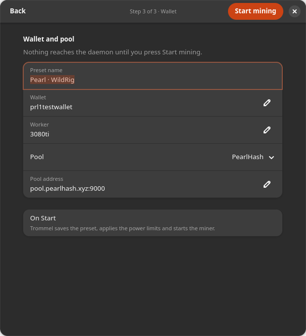
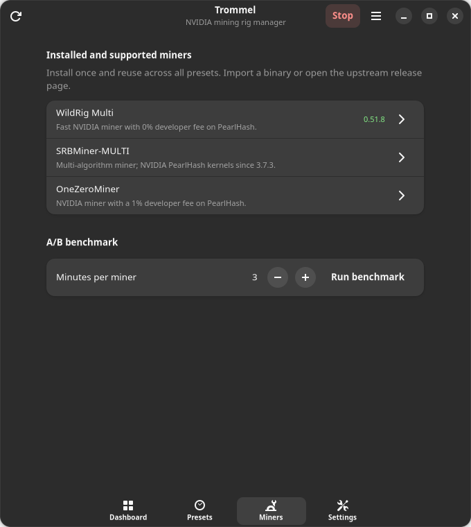
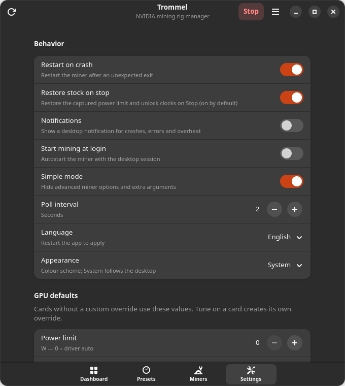

# Trommel user guide

Trommel controls a local NVIDIA rig: it stores presets, installs miners, applies
power/clocks, starts exactly one miner and restores the stock GPU state when
mining stops. The daemon keeps working after the window is closed.

Russian: [user-guide.ru.md](user-guide.ru.md).

## Install

Download the latest `.deb` from GitHub Releases
(<https://github.com/nayvok/trommel/releases/latest>) and install it with
`sudo apt install ./trommel_amd64.deb`, or run the release
`trommel-install.sh`, which verifies the SHA-256 first. There is no apt
repository or PPA; upgrades are new release downloads.

`./install.sh` is the developer path. A working NVIDIA driver and `nvidia-smi`
are required. The app talks to the daemon over D-Bus; the daemon runs as your
user, and the narrow GPU helper runs through polkit — without a password for the
user who installed the package.

## First run: Quick setup

Simple mode is on by default: the preset editor hides raw miner arguments and
per-miner options. Turn it off in **Settings → Behavior → Simple mode** if you
need them.

The dashboard shows **Quick setup** until a wallet and an installed miner are
ready. It opens a three-step wizard for a rig with one to three cards:

1. **Cards** — every detected GPU has a switch and its own power limit. Untick a
   card to leave it untouched. **Apply 80 %** sets 80 % of each ticked card's
   stock limit, expands the rows and writes the applied watts back into them;
   **Use auto** clears the limit. This is a safe start with clock locks off, not
   a promise of maximum hashrate.
2. **Miner** — pick a miner and version. **Install…** opens the shared install
   dialog: download a catalogue version, type a version newer than the catalogue,
   or import a local binary. The version is installed once for every preset;
   only one miner runs at a time.
3. **Wallet** — preset name, wallet, worker, pool and pool address. Nothing is
   sent to the daemon until you press **Start mining**; incomplete wallet or pool
   address is explained in the wizard. With a running miner the wizard saves the
   draft and shows the usual Apply and restart / Apply and stop dialog — it never
   restarts silently.



The classic path still works: create or open a preset in **Presets**, choose a
pool, a miner version and wallet/worker, then Save and apply and press Start.
Before the miner starts, Trommel snapshots each enabled card's power limit and
clocks; Stop restores the snapshot. If restore fails, the snapshot is kept and
the error is shown.

## Dashboard

- The hero card shows total hashrate, the state pill (`mining`, `external`, `stopped`,
  `offline`), the active preset/miner/version and the fee
  breakdown.
- Every GPU is a card with live power, core/memory clocks, temperature, fan and
  utilisation in value bubbles, plus a switch that includes the card in the
  active profile. A single-GPU rig uses one full-width card; with two or more
  cards each keeps the compact tile. Click **Tune** to edit its power limit and
  clock locks.
- Below the cards: total power, maximum temperature, accepted/rejected shares,
  pool balance, the configured pool endpoint with its fee, and warnings.
- When the miner is stopped, hashrate and balance show numeric placeholders and
  the pool row still names the configured endpoint.
- The header **Start** applies your edited draft before starting. If the wallet
  or miner is missing, it opens Quick setup instead of failing with a toast. It
  is disabled while every detected GPU is switched off; the warning row explains
  why.
- Action errors show a **Details** button. The dialog keeps the full message
  selectable and offers **Copy**, so a long daemon error does not disappear in a
  truncated toast.

## Presets and installed miners

A preset bundles coin/algorithm (Pearl/pearlhash in the current catalogue),
pool, wallet, worker, miner version and miner options. GPU settings are edited
on each card's **Tune** dialog (global defaults in **Settings → GPU defaults**),
not in the preset editor. A preset references a miner **version**,
not a path. Installing a version once makes every preset that references it see
the version as installed. If a preset references a missing version, Start is
blocked until you install it or switch to an installed version. There is no
uninstall action yet.


Presets open in a modal editor with **Cancel**/**Save** in the header and
**Duplicate**/**Delete…** in the footer. Saving applies immediately: a stopped
miner is saved at once; a running miner gets the restart/stop dialog. Deleting
asks for confirmation, names the preset, and explains that the daemon keeps
mining with the previously applied preset until another one is applied.


## Miner installation

The install dialog is the only place that installs miners, and it is shared by
the Miners page, the preset editor and the wizard:




- pick a catalogue version or type your own version name;
- download from an HTTPS URL (optional SHA-256; `tar.gz`, `zip` or a raw binary);
- or import a local executable.

Imported builds are copied into Trommel's managed store, so moving or deleting
the original download does not break the preset. Downloads are size-limited and
archive paths are validated. An install without a SHA-256 is recorded as
unverified; supply one whenever the release publishes it.

The catalogue is a convenience, not a gate: if a miner released a new build
before the catalogue was updated, type the version and paste the upstream URL.

## Settings



- **Behavior** — restart on crash, restore stock on stop (on by default),
  notifications, start mining at login, simple mode, poll interval, language
  (needs an app restart) and appearance.
- **GPU defaults** — power limit (`0 = driver auto`), optional core/memory clock
  locks, temperature limit and resume temperature. Cards without their own
  override inherit these values.
- **Actions** — **Save and apply**, **Copy diagnostics** (redacted), **Restore
  stock**.

The per-card **Tune** dialog on the dashboard is the only place that edits a
single card's override; Settings no longer repeats the card list.

## Clock locks (advanced)

Core and memory clock locks are opt-in and off in a fresh profile. Turn off
**Simple mode** to see them in **Settings → GPU defaults** and in each card's
**Tune** dialog.


The tuning dialog starts with a **Now** row so you can compare the target with
the live state. A clock value row is visible only while its lock switch is on.
The **⋯** menu holds **Recommended** (80 % of the stock power limit with both
locks off — a safe start, not an optimum) and **Profile default** (remove this
card's override). On a multi-GPU machine **Apply to** copies the values to
similar cards or all cards.


A lower memory clock can reduce power/heat and sometimes raise hashrate on
PearlHash-like coins, but it can hurt other algorithms; test with the A/B
benchmark. Stop resets the locks to the driver default.

## Fees

The miner developer fee comes from the catalogue and is fixed unless the
catalogue marks it configurable. The pool fee is used for the effective hashrate
calculation. The total is shown in the dashboard and the preset editor:

```
miner 0.00% + pool 1.00% = total 1.00%
```

The UI never pretends a fixed fee can be changed.

## Miner options

The options section is built from the selected miner's descriptors: types,
ranges, defaults and CLI flags come from the catalogue for the selected miner.
Changing the miner rebuilds the rows; values whose keys the new miner does not
define are dropped when the preset is saved. Extra arguments are appended
verbatim as an argument vector (no shell). In simple mode both sections are
hidden.

## Apply while mining

If the miner is running and you change a GPU/profile setting, **Apply** asks:

- **Apply and restart** — stop, restore stock, save, start again.
- **Apply and stop** — stop, restore stock, save the new config, stay stopped.
- **Cancel** — keep the old applied config and your draft; optimistic switch
  changes are undone.

A live-only change (language, notifications, autostart) is applied without a
restart. A failed start saves the previous config back and attempts a
best-effort stock restore.

## Stock restore and limitations

- **Restore stock** (Settings → Actions) asks first: it can restore the snapshot
  captured before mining (`350 W`, clocks unlocked) or reset to the driver
  default when the snapshot itself already had a reduced limit. The dialog shows
  the exact target and warns when the two differ.
- The power limit is restored from the snapshot captured before mining and read
  back; a mismatch is an error, not a silent “applied”. The snapshot is kept
  when the restore fails, so you can retry.
- `-lgc`/`-lmc` are reset to the driver default. A pre-existing manual clock
  lock cannot be read back through `nvidia-smi`; the UI says so, and a warning
  appears when the driver does not honour a configured lock.
- Memory/core locks are checked once the miner has loaded the GPU. If the
  driver ignores the memory lock, the miner is stopped and the error names the
  requested/actual frequency; remove the lock from the profile or update the
  driver.
- **Restore stock on stop** can be turned off. In that case Stop keeps the
  snapshot and leaves the power/clocks applied; the dashboard shows a banner
  with **Restore stock** and the status warning explains why. Turning it off is
  never silent.
- A profile with no power/clock values touches nothing: Start needs no snapshot,
  no helper and no password, so a pure stock profile can keep restore-on-stop
  enabled.
- Per-card settings inherit the **GPU defaults** unless the card has a custom
  override. The setup wizard and the enable switch do not create an override;
  **Tune → Save** does. Each dashboard card shows “custom” or “profile default”.
- Fan control on consumer cards is not available through `nvidia-smi`; fan flags
  are passed to the miner when supported and disappear with the process.
- On reboot the snapshot is marked stale and is not used; Start captures a fresh
  one, and the driver resets GPU settings anyway.
- Trommel does not kill a miner it did not start. Stop that process yourself
  before pressing Start.

## Notifications

**Behavior → Notifications** turns crash, error and overheat events into regular
desktop notifications. The daemon sends them through
`org.freedesktop.Notifications`, so they work on any freedesktop desktop and do
not need a shell extension. The same events are also emitted as the
`Notification` D-Bus signal for custom integrations.

## Benchmarks

**Miners → A/B benchmark** (or `trommel bench --minutes 3`) stops mining, runs
each selected miner sequentially, records raw and fee-adjusted effective
hashrate, restarts the previous miner if it was running, and prints the winner.
Benchmarking moves a real rig: the miner stops for the duration of the test.

## Asking an external agent

Use **Settings → Actions → Copy diagnostics** or `trommel diagnose --json` to
create a redacted bundle, then give it to Codex/ChatGPT together with the config
schema. `trommel config diff proposed.json` shows whether a change needs a
restart; `trommel config apply proposed.json --restart` applies it after you
review the diff. For MCP-aware agents, run `trommel mcp` (read-only) or
`trommel mcp --allow-write`. See [agents.md](agents.md).

## Troubleshooting

- **Service is not running** — `systemctl --user start trommeld` or just reopen
  the app; D-Bus activation should start it. Check
  `journalctl --user -b -u trommeld`.
- **GPU unavailable** — check `nvidia-smi` as your user; a container or Flatpak
  sandbox may hide the device nodes.
- **OC not applied** — check the polkit helper/policy. The app aborts the start
  when tuning was requested and failed, instead of mining with unknown clocks.
  Run `./scripts/check-polkit.sh` and reinstall the rule.
- **Start says the miner is missing** — install the referenced version or switch
  the preset to an installed one; installs are global, not per preset.
- **No pool balance** — the pool API is cached for a minute and backs off after
  failures; only PearlHash has an account API adapter.
