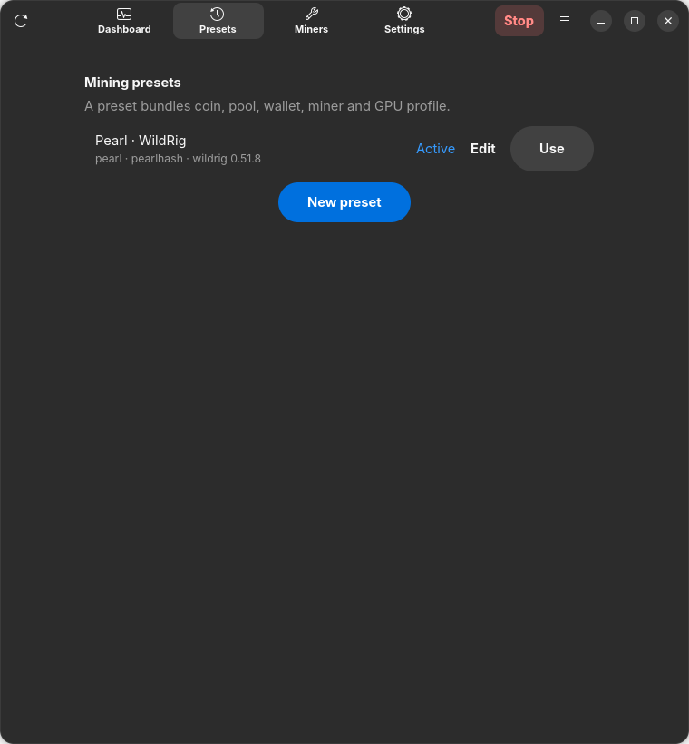
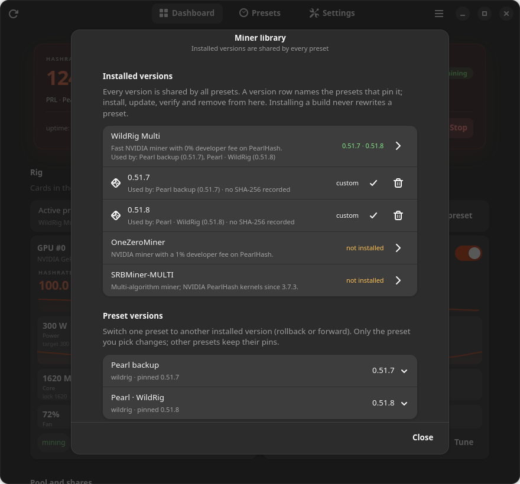
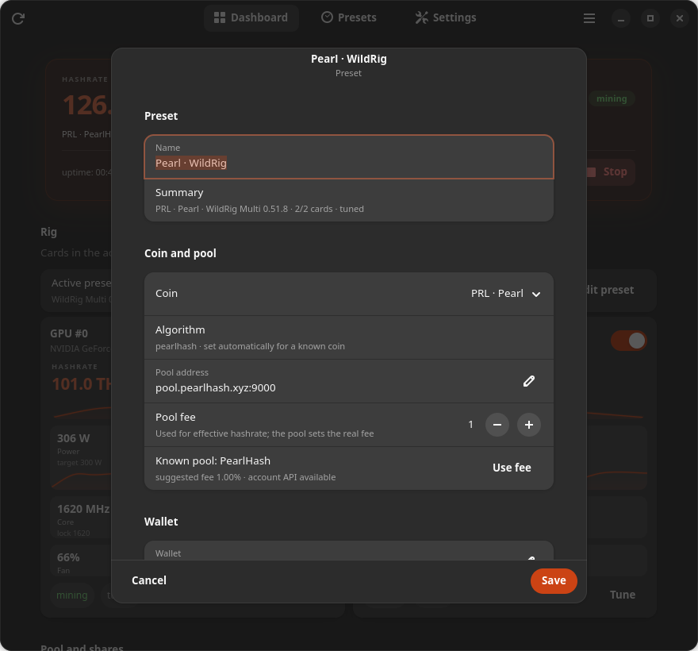
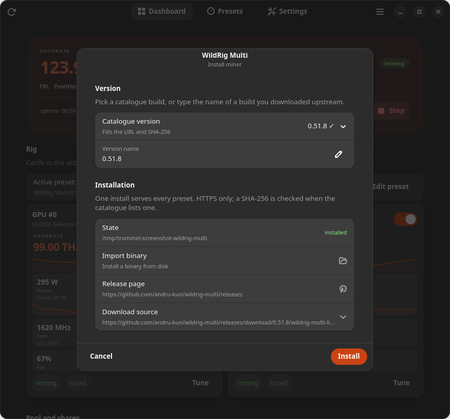
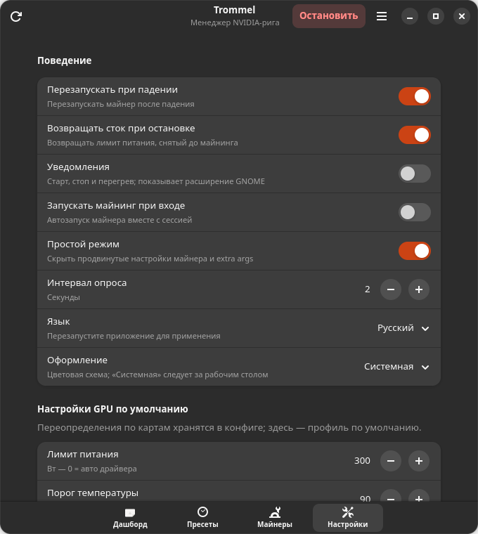
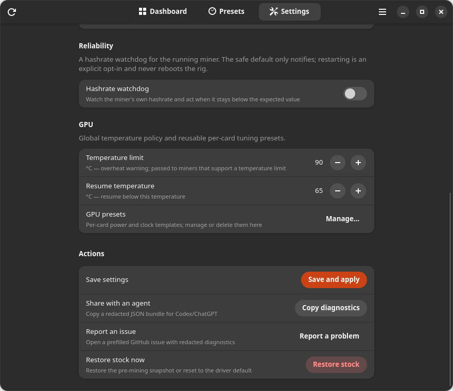
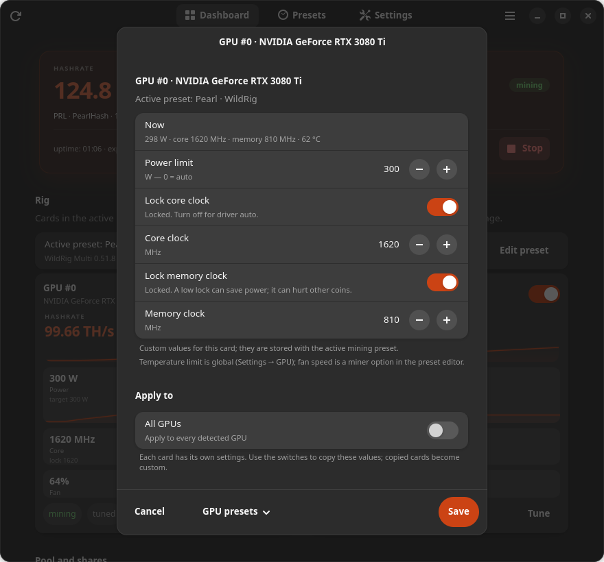

# Руководство пользователя Trommel

Trommel управляет локальным NVIDIA-ригом: хранит пресеты, устанавливает
майнеры, применяет питание и частоты, запускает ровно один майнер и возвращает
стоковое состояние GPU при остановке. Демон продолжает работать после закрытия
окна.

English: [user-guide.md](user-guide.md).

## Установка

Скачайте последний `.deb` из GitHub Releases
(<https://github.com/nayvok/trommel/releases/latest>) и поставьте его:
`sudo apt install ./trommel_amd64.deb`. Либо запустите `trommel-install.sh` из
релиза — он сначала проверит SHA-256. Apt-репозитория и PPA нет; обновление —
установка нового релиза.

`./install.sh` — путь для разработчиков. Нужны рабочий драйвер NVIDIA и
`nvidia-smi`. Приложение общается с демоном по D-Bus; демон работает от вашего
пользователя, а узкий GPU-хелпер запускается через polkit — без пароля для
пользователя, который ставил пакет. Фоновый сервис и трей по умолчанию
запускаются при входе; выключить можно в
**Настройки → Поведение → Запускать Trommel при входе**.

## Первый запуск: создайте пресет

Простой режим включён по умолчанию: редактор пресета скрывает сырые аргументы и
опции майнера. Выключить — **Настройки → Поведение → Простой режим**.

На чистой установке **пресета нет**. Дашборд — первая страница: он показывает
обнаруженные карты, а hero объясняет, что нужен пресет. Нажмите **Создать
пресет** (или **Запустить** — будет то же объяснение), чтобы открыть редактор.

Пресет хранит:

1. **Майнинг** — имя, монету, алгоритм, кошелёк и воркер. Список монет
   фильтруется по алгоритмам, которые заявляет выбранный майнер; монету вне
   списка можно добавить как **Свою** — с символом, названием, алгоритмом,
   префиксом кошелька и единицей хешрейта.
2. **Майнер** — майнер и версию. **Установить…** открывает общий диалог
   установки: скачать версию из каталога, ввести версию новее каталога или
   импортировать локальный бинарник. Установка одна для всех пресетов;
   одновременно работает один майнер.
3. **Пул** — адрес пула вводится вручную (`host:port`); выпадающего списка
   пулов нет. Комиссия пула используется для расчёта effective hashrate. Если
   host совпадает с известным пулом, Trommel предложит его комиссию и
   документированный JSON API аккаунта; иначе можно указать необязательный
   **Pool API URL**. Без него дашборд честно скажет, что данных баланса нет.
4. **Настройки GPU** — у каждого пресета майнинга свои участие карт, лимит
   питания и локи частот. Нажмите **Настроить** на карте дашборда. Новый пресет
   начинается со стока; последние значения сохраняются в пресете, поэтому
   переключение пресетов возвращает соответствующую настройку GPU.

Сохраните пресет и нажмите **Запустить**. Перед стартом Trommel снимает
стоковый лимит питания и частоты каждой участвующей карты; «Остановить»
возвращает снимок. Если возврат не удался, снимок сохраняется, а ошибка
показывается.

## Дашборд

- Hero-карточка показывает суммарный хешрейт, статусную пилюлю (`майнится`,
  `вручную`, `остановлен`, `нет связи`) и строку «монета · пул · комиссия».
  Имя пресета здесь не повторяется: оно живёт в строке **Активный пресет**.
- Каждая карта — карточка с якорем хешрейта (значение карты от майнера и
  спарклайн за пять минут, либо `—`, если майнер его не отдаёт), живыми
  питанием, температурой, частотами ядра/памяти, вентилятором и загрузкой в
  «пузырях» со значениями, а также переключателем участия карты в сессии
  майнинга. На риге из одной карты
  карточка занимает всю ширину; при двух и более картах остаются компактные
  плитки. Спарклайн за последние пять минут есть только у **питания** и
  **температуры**; ядро, память, вентилятор и загрузка — значения, а не тренды.
  Наведение на график показывает минимум и максимум за интервал. Кнопка
  **Настроить** открывает диалог карты. Чип карты показывает **майнит** или
  **исключена**; строка **Активный пресет** показывает майнер/версию, число
  карт, сток/настроено, питание и температуру рига.
- Строка метаданных hero сравнивает ожидаемый хешрейт из пресета с фактическим
  и показывает эффективность в единице монеты (`J/TH` для Pearl, `J/MH` для
  Ravencoin/Zilliqa). Эффективность считается только по участвующим картам;
  питание рига в строке «Активный пресет» по-прежнему учитывает все карты.
- **Пул и шары** — одна группа: имя/хост пула, endpoint, комиссия и наличие API;
  принятые/отклонённые/устаревшие шары с процентом принятия; баланс к выплате.
  Без API пула или до первого ответа баланс — **—** с объяснением в подсказке;
  он никогда не показывается как `0.000`. При отсутствии пресета группа скрыта.
- Запущенный майнер без данных показывает **—**, а не `0`; реальный ноль от
  майнера или пула по-прежнему отображается как `0`. В остановленном состоянии
  строка пула всё равно называет настроенный endpoint.
- Кнопка **Запустить** в hero-карточке дашборда сначала применяет черновик.
  Если нет кошелька или майнера, она открывает быструю настройку, а не выдаёт
  ошибку в тосте. Пока все обнаруженные карты исключены из майнинга, кнопка
  неактивна, а строка замечаний объясняет почему. Во время майнинга та же кнопка
  называется **Остановить**.
- Ошибки действий показывают кнопку **Подробнее**: полный текст можно выделить и
  скопировать, а не ловить обрезанный тост.

### Исключение карты

Выключите переключатель карты, чтобы исключить её из майнера. Исключённая карта
**не** передаётся майнеру, не получает разгон по питанию и частотам и
возвращается к стоковым настройкам, если прошлая сессия с выключенным возвратом
стока оставила на ней разгон. Карта остаётся видимой с живыми температурой,
питанием и вентилятором и помечается **исключена**; «Итого» показывает, сколько
обнаруженных карт майнят.

Исключение передаётся майнеру через флаг, задокументированный этим майнером:

| Майнер | Флаг |
| --- | --- |
| WildRig Multi | `--gpu-list` |
| SRBMiner-MULTI | `--gpu-id` |
| OneZeroMiner | `--devices` |

Если у выбранного майнера нет задокументированного флага выбора устройств,
«Запустить» отказывает при исключённой карте, а не тихо запускает майнер на всех
картах. Включите все карты или выберите майнер с поддержкой выбора устройств.
У собственного/импортированного id майнера нет возможности каталога, поэтому он
работает только со всеми картами.

Номера устройств — это индексы `nvidia-smi`, показанные как `GPU #N` на
карточках. Если майнер нумерует устройства иначе, проверьте результат
бенчмарком. Исключение или возврат карты во время майнинга проходит через
обычный диалог «Применить и перезапустить / Применить и остановить».

## Пресеты и установленные майнеры

Пресет объединяет монету/алгоритм (Pearl/pearlhash в текущем каталоге), пул,
кошелёк, воркер, версию майнера и опции майнера. Настройки GPU редактируются
в диалоге **Настроить** на карточке, а не в редакторе пресета. Пресет ссылается на **версию** майнера, а не на
путь. Установленная версия считается установленной в любом пресете. Если
версии нет, строка пресета сообщает об этом, старт заблокирован, а
**Установить…** открывает библиотеку майнеров с фокусом на этом пресете.
Установленными версиями управляют в библиотеке: их можно проверить, обновить,
удалить и перевести один пресет на старую версию. Ничего не меняет пресеты
молча — см. [Версии майнеров](#версии-майнеров).



Строка **Библиотека майнеров** на странице «Пресеты» открывает диалог
библиотеки. В нём каталог майнеров, все установленные версии с пресетами,
которые их закрепили, переключатель версии для каждого пресета и
A/B-бенчмарк:



Пресеты открываются в модальном редакторе: сводка сверху, затем группы
**Монета и пул**, **Кошелёк**, **Майнер**, **GPU** и **Дополнительно**;
**Отмена**/**Сохранить** в нижней панели, **Дублировать**/**Удалить…** в конце
страницы. Алгоритм известной монеты только для чтения (подставляется
автоматически), у своей монеты поле остаётся редактируемым. В
**Дополнительно** лежат опции майнера, API пула, порт API, переопределение
комиссии и доп. аргументы; простой режим скрывает эту группу. Сохранение
применяется сразу: остановленный майнер сохраняется, работающий получает
диалог перезапуска/остановки. Удаление спрашивает подтверждение, называет
пресет и объясняет, что демон продолжит майнить с ранее применённым пресетом,
пока не применят другой.



## Установка майнера

Диалог установки — единственное место, где ставятся майнеры; он общий для
библиотеки майнеров, редактора пресета и мастера:



- выбрать версию из каталога или ввести своё имя версии;
- нажать **Установить**, чтобы скачать её по HTTPS (в строке **Источник
  загрузки** можно поменять URL, добавить SHA-256 или выбрать `tar.gz`, `zip`
  или сырой бинарник);
- или импортировать локальный исполняемый файл.

Импортированные сборки копируются в управляемое хранилище Trommel, поэтому
перемещение или удаление исходной загрузки не ломает пресет. Загрузки ограничены
по размеру, пути в архивах проверяются. Установка без SHA-256 записывается как
непроверенная; указывайте сумму, если релиз её публикует.

Каталог — удобство, а не шлагбаум: если майнер выпустил сборку раньше, чем
обновился каталог, введите версию и вставьте upstream-ссылку.

### Версии майнеров

Установленные сборки глобальны, и несколько версий одного майнера могут
оставаться установленными. Библиотека показывает по строке на версию под её
майнером:

- строка называет пресеты, которые закрепили эту версию, и их версии;
- видно, существует ли бинарник и исполняем ли он, и был ли записан SHA-256 —
  Trommel никогда не выдумывает контрольную сумму;
- **Проверить** (иконка проверки) повторно проверяет бинарник, сообщает
  результат тостом и помечает строку как **проверено**, пока библиотека
  открыта. **Удалить** (иконка корзины) — явное удаление.

**Обновление** — это установка другой версии в общем диалоге установки.
Сборка добавляется рядом с уже установленными, и **ни один пресет не
переписывается**. После установки Trommel показывает пресеты, закреплённые за
другой версией, и спрашивает, какие из них перевести; по умолчанию ничего не
выбрано, а кнопка **Оставить версии пресетов** — основная, поэтому пресеты
остаются как были, пока вы не выберете иное.

**Удаление** никогда не происходит молча:

- пока версию использует хотя бы один пресет, действие блокируется со списком
  этих пресетов. Сначала переведите их на другую установленную версию;
- для неиспользуемой версии запрашивается подтверждение с объяснением, что
  управляемый бинарник будет удалён (или удалится только запись об установке,
  если бинарник вне управляемого хранилища), все пресеты останутся как есть, а
  другие версии сохранятся.

**Откат** — это переключатель в группе **Версии в пресетах**: выберите пресет,
укажите любую другую установленную версию и подтвердите. Меняется только этот
пресет; остальные сохраняют закрепления. Если изменяемый пресет — тот, на
котором работает майнер, изменение проходит через обычный диалог **Применить и
перезапустить / Применить и остановить**. Сборка с отсутствующим бинарником видна в списке, но выбрать её
нельзя.

## Настройки



- **Поведение** — перезапуск при падении, возврат стока при остановке (включён
  по умолчанию), уведомления, запуск Trommel при входе (включён по умолчанию;
  сервис и трей, не майнинг), монохромная иконка в трее (включена по
  умолчанию), порог температуры и температура возобновления (глобальные:
  предупреждение о перегреве и передача майнерам с поддержкой), запуск
  майнинга при входе, простой режим, интервал опроса, язык (нужен перезапуск
  приложения) и оформление.
- **GPU** — глобальный порог температуры/возобновления и **Пресеты GPU** —
  единственное место, где можно переименовать или удалить сохранённые шаблоны
  карт.
- **Действия** — **Сохранить и применить**, **Копировать диагностику** (с
  редакцией кошельков), **Вернуть сток**.

Отдельная настройка карты живёт только в диалоге **Настроить** на дашборде;
в «Настройках» список карт больше не дублируется.

## Локи частот (продвинутое)

Локи ядра и памяти опциональны и в новом профиле выключены. Выключите **Простой
режим**, чтобы увидеть их в диалоге **Настроить**.



Диалог начинается со строки **Сейчас**, чтобы сравнить цель с живым состоянием.
Строка значения частоты видна только при включённом локе. В футере —
**Отмена**, меню **Пресеты GPU** и **Сохранить**. В меню: **Сток (по
умолчанию)** (авто-питание и частоты драйвера), сохранённые пресеты для карты
и **Сохранить как пресет GPU…**. Переименование и удаление сохранённых
шаблонов живёт в **Настройки → GPU → Управление…**, а не в меню Tune. Выбор
пресета меняет только поля диалога; до нажатия **Сохранить** в сервис ничего не
уходит.
**Отмена** и закрытие диалога отбрасывают локальные изменения и не показывают
алерт применения. На риге с несколькими картами **Применить к** копирует
значения на одинаковые или все карты; копии становятся custom и не выдают себя
за пресет другой карты.



Низкий лок памяти может снизить питание и нагрев, а иногда поднять хешрейт на
PearlHash-подобных монетах, но может навредить другим алгоритмам — проверяйте
A/B-бенчмарком. «Остановить» сбрасывает локи в дефолт драйвера.

## Комиссии

Комиссия разработчика майнера берётся из каталога и фиксирована, если каталог не
разрешает её менять. Комиссия пула редактируется в пресете и используется
для расчёта effective hashrate. Итог виден на дашборде и в редакторе пресета:

```
майнер 0.00% + пул 1.00% = итого 1.00%
```

UI не делает вид, что фиксированную комиссию можно поменять.

## Опции майнера

Раздел опций строится из дескрипторов выбранного майнера: типы, диапазоны,
умолчания и CLI-флаги берутся из каталога для выбранного майнера. При смене
майнера строки пересобираются; значения, чьи ключи новый майнер не определяет,
отбрасываются при сохранении пресета. Доп. аргументы добавляются как вектор
аргументов (без shell). В простом режиме оба раздела скрыты.

## Применение при работающем майнере

Если майнер работает, а вы меняете настройки GPU/профиля, **Применить**
спрашивает:

- **Применить и перезапустить** — остановить, вернуть сток, сохранить, запустить
  снова.
- **Применить и остановить** — остановить, вернуть сток, сохранить новый конфиг и
  остаться остановленным.
- **Отмена** — оставить прежний применённый конфиг и ваш черновик; оптимистичные
  изменения переключателей откатываются.

Изменения только «на живую» (язык, уведомления, автозапуск) применяются без
перезапуска. Неудачный старт сохраняет прежний конфиг и делает best-effort
возврат стока.

## Возврат стока и ограничения

- **Вернуть сток** (Настройки → Действия) сначала спрашивает: вернуть снимок,
  снятый до майнинга (`350 W`, частоты разлочены), или сбросить на сток
  драйвера, если в самом снимке уже был сниженный лимит. В диалоге видны точные
  цели и предупреждение, если они различаются.
- Лимит питания возвращается из снимка и проверяется чтением обратно;
  расхождение — ошибка, а не молчаливое «применено». При неудаче снимок
  сохраняется, чтобы можно было повторить.
- `-lgc`/`-lmc` сбрасываются в дефолт драйвера. Свой ручной лок, стоявший до нас,
  через `nvidia-smi` не прочитать; UI это говорит, а при неподтверждённом локе
  появляется предупреждение.
- Локи памяти/ядра проверяются, когда майнер нагрузил карту. Если драйвер
  игнорирует лок памяти, майнер останавливается, а в ошибке указаны заданная и
  фактическая частоты; уберите лок из профиля или обновите драйвер.
- **Возврат стока при остановке** можно выключить. Тогда Stop сохраняет снимок
  и оставляет питание/частоты применёнными; на дашборде появляется баннер с
  кнопкой **Вернуть сток**, а в замечаниях — объяснение. Это не происходит молча.
- Сессией владеет демон, а не окно: закрытие или крах GUI никогда не
  останавливает майнинг. Если убит сам демон, unit systemd или guard выполняет
  аварийную остановку, возвращает снимок и **не** возобновляет майнинг; следующий
  запуск начинается остановленным. Если возврат не удался, баннер и последняя
  ошибка остаются до успешной повторной попытки.
- Профиль без питания/локов ничего не трогает: Start не снимает снимок, не
  вызывает helper и не просит пароль. Чисто стоковый профиль может держать
  возврат стока включённым.
- Настройки карты наследуют GPU-настройки пресета (авто-питание драйвера, без
  локов частот), пока у карты нет собственной настройки. Переключатель карты
  override не создаёт; его создаёт **Настроить → Сохранить**. На карточке видно
  **сток**, **настроено** или **пресет GPU**.
- Вентилятор на consumer-картах через `nvidia-smi` не управляется; fan-флаги
  уходят майнеру, если он их поддерживает, и исчезают вместе с процессом.
- После перезагрузки снимок помечается stale и не используется; Start снимет
  новый, а драйвер и так сбрасывает настройки GPU.
- Trommel не убивает майнер, который запустил не он. Остановите такой процесс
  сами, прежде чем нажимать «Запустить».

## Уведомления

**Поведение → Уведомления** превращает падение, ошибку и перегрев в обычные
desktop-уведомления. Их отправляет демон через `org.freedesktop.Notifications`,
поэтому они работают в любом freedesktop-окружении и не требуют расширения
оболочки. Те же события уходят сигналом `Notification` по D-Bus для своих
интеграций.

## Трей

Иконка в трее принадлежит фоновому сервису `trommeld`, поэтому она доступна
даже при закрытом главном окне. Меню рисует панель; в нём есть строка статуса
(`Майнинг остановлен` или `Майнинг · <пресет> · <хешрейт>`), разделитель,
**Запустить майнинг** / **Остановить майнинг**, **Показать окно** и **Выход**.

- **Запустить/остановить** использует тот же супервизор и защиту от
  параллельных операций, что и дашборд; второй майнер не запускается.
- **Показать окно** запускает Trommel или поднимает уже открытое окно.
- **Выход** останавливает только майнер Trommel, возвращает снятый лимит
  питания и частоты, просит открытое окно закрыться и завершает демон. После
  выхода не остаётся ни одного процесса Trommel; чтобы вернуть трей, запустите
  приложение снова.

KDE Plasma поддерживает трей нативно. В GNOME Shell нужно расширение
AppIndicator — в Ubuntu оно уже установлено как `ubuntu-appindicators`; в
других сборках GNOME включите «AppIndicator and KStatusNotifierItem Support».
Без хоста StatusNotifierItem иконки просто нет, остальные возможности работают.
Windows не поддерживается.

Переключатели находятся в **Настройки → Поведение**:

- **Использовать монохромную иконку в трее** (включена по умолчанию) рисует
  тот же барабан одним цветом; выключите для цветной иконки. Изменение
  применяется при следующем обновлении статуса.
- **Запускать Trommel при входе** (включён по умолчанию) запускает фоновый
  сервис и трей при входе. Майнинг при этом **не** запускается; для него есть
  отдельный переключатель **Запускать майнинг при входе**.


## Бенчмарки

**Пресеты → Библиотека майнеров → A/B-бенчмарк** (или
`trommel bench --minutes 3`) останавливает майнинг, последовательно запускает
выбранные майнеры, записывает сырой и скорректированный на комиссии
effective-хешрейт, перезапускает прежний майнер, если он работал, и показывает
победителя. Бенчмарк останавливает реальный майнинг на время теста.

## Внешний агент

**Настройки → Действия → Копировать диагностику** или `trommel diagnose --json`
создаёт пакет с редакцией кошельков; передайте его Codex/ChatGPT вместе со схемой
конфига. `trommel config diff proposed.json` показывает, нужен ли перезапуск;
`trommel config apply proposed.json --restart` применяет после просмотра diff.
Для MCP-агентов — `trommel mcp` (только чтение) или
`trommel mcp --allow-write`. См. [agents.md](agents.md).

## Решение проблем

- **Сервис не запущен** — `systemctl --user start trommeld` или просто откройте
  приложение; D-Bus-активация должна поднять сервис. Смотрите
  `journalctl --user -b -u trommeld`.
- **GPU недоступен** — проверьте `nvidia-smi` от своего пользователя; контейнер
  или песочница Flatpak могут скрывать устройства.
- **Разгон не применился** — проверьте polkit-хелпер/политику. Приложение
  прерывает старт, если разгон был запрошен и не удался, вместо майнинга с
  неизвестными частотами. Запустите `./scripts/check-polkit.sh` и переустановите
  правило.
- **Старт пишет, что майнер не установлен** — установите нужную версию или
  переключите пресет на установленную; установки глобальные, не по пресетам.
- **Старт отказывает, потому что майнер не умеет выбирать карты** — карта
  исключена, но у выбранного майнера нет задокументированного флага выбора
  устройств. Включите все карты или выберите майнер с поддержкой выбора; Trommel
  не запускает майнер на всех картах в обход исключения.
- **Нет баланса пула** — API пула кэшируется на минуту и делает backoff после
  ошибок; адаптер аккаунта есть только у PearlHash.
